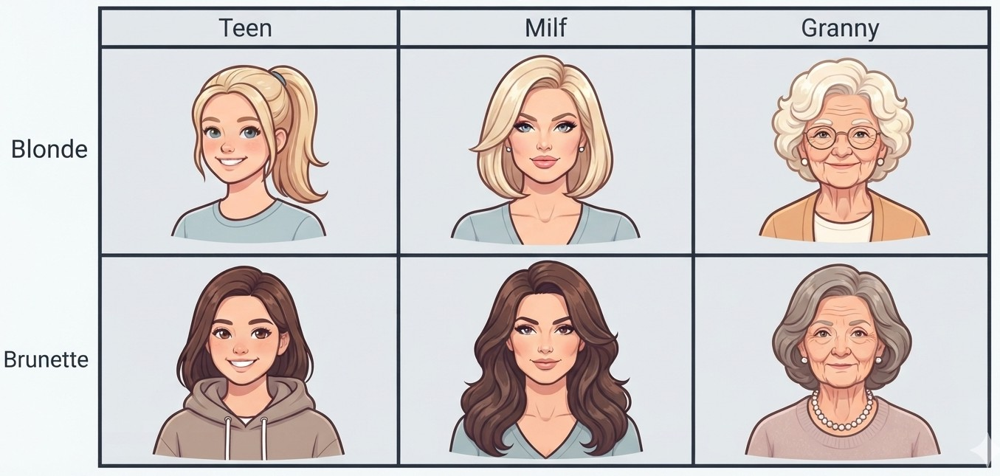
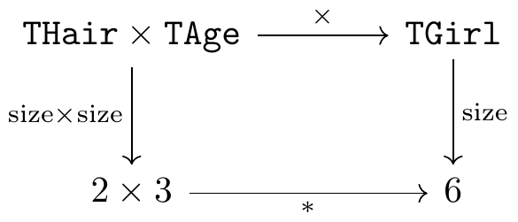
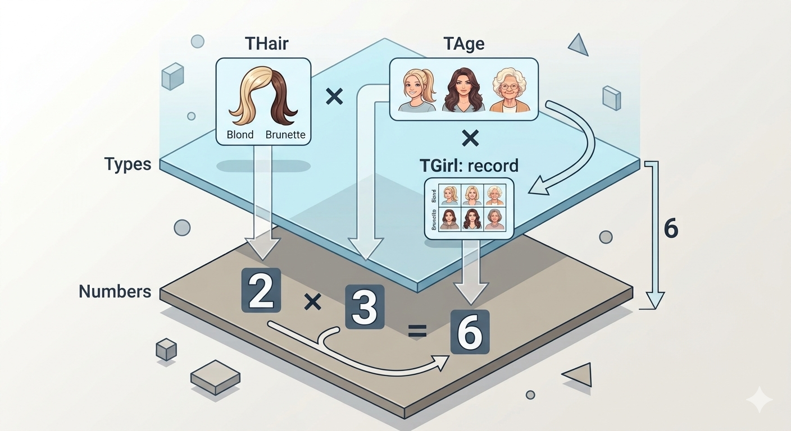
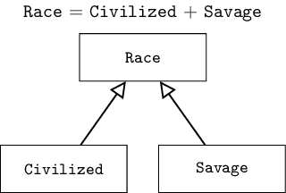

# Algebraic Data Types

I think a lot of readers have heard about algebraic data types (ADT), know it lives somewhere in Haskell, OCaml, Rust or Scala, but never really dug into it.
In this article I'll unpack what it actually is, with a bit of an emphasis on the math.


## Data types

Let's start by decoding the name.
First word, "algebra".
It shows up as far back as al-Khwarizmi's works, which also gave us the word "algorithm".
Think back to school math class.
There was algebra, there was geometry, and later on calculus.
Algebra meant x's and y's, polynomials, graphs, functions, logarithms, and so on.
But that was algebra of numbers, maybe a bit of algebra of polynomials.
You can also talk about algebra of matrices, tensors, and algebras of objects that have nothing to do with numbers at all, like permutations, strings, and so on.
In general, mathematically, an algebra is a set of objects plus operations between them.
So an algebra of types is types plus operations between them.

Fine, but what is a "data type"?
You can define without much trouble what a data type is in a specific programming language, like C# or Python.
But defining a data type across all programming languages is pretty hard.
Whenever I asked this question, I'd often hear back that it's some kind of contract
that defines which operations are allowed on the data and which aren't.
Yes, that's close, but that definition isn't mathematical, there's a lot you can argue about there.

The harsh truth is that mathematically we can give two definitions.
First, a data type is some information that exists only at compile time (or during whatever other semantic check runs on the code),
whose purpose is to prevent a certain class of errors.
Sure, maybe we'd love to write `1 + "test"` in Java, but the compiler won't let us.
This is how types are treated in statically typed languages.
Second, a data type is part of a value, but it describes the other parts of it.
This is how types are treated in dynamically typed languages.

Take Python. From the point of view of the first definition, there's really only one type in the language, `PyObject`.
The usual data types like `int`, `string`, or arrays in C# are instances of the first definition.

It's worth saying that in real life types have become somewhat hybrid.
Even in C++ there's RTTI, meaning part of a type carries a pointer that lets you figure out the structure of your type at runtime.
And Python has type annotations, which have zero effect on execution but help linters out.

For the purposes of this article I'll keep talking about types only in the sense of the first definition,
without calling that out separately each time.


## Product of types

OK, we've got a handle on what a data type is, let's try to invent at least one operation, just for practice.
For that we'll need a couple of example types to play with.
Let one contain two values, the other three.
Then the first one could be

```
type THair = (Blonde, Brunette);
type Hair = "Blonde" | "Brunette";
enum Hair { Blonde, Brunette };
```

and the second:

```
type TAge = (Teen, Adult, Granny);
type Age = "Teen" | "Adult" | "Granny";
enum Age { Teen, Adult, Granny };
```

Our intuition immediately tells us how to build a third type out of these two: just combine them as fields.
We get a new type

```
type TGirl = record hair: THair; age: TAge end;
type Girl = { hair: Hair; age: Age };
struct Girl { hair: Hair, age: Age };
```

Let's visualize it.



Now let's look at it more closely.
We can see that `Hair` had two values, `Age` had three, and the result, `Girl`, has six.
`2 * 3 = 6`. That's multiplication!
That's exactly why this operation on types is called a product.
For our example it looks like this.



This shows that it doesn't matter which route we take from the pair of types `Hair` and `Age` toward the number 6.
We can first multiply the types and then count the size of the result.
Or we can first count the size of each type separately, and then multiply the resulting numbers.
The result will be the same either way.

So, in a way, we have two floors.
On the upper floor live types.
On the lower floor live numbers.
At any convenient moment we can step down from the upper floor to the lower one, and keep traveling there instead.
Nothing on the lower floor will get in our way.




## Sum of types

Now we're ready to carry concepts over from the world of numbers into the world of types.
We've carried over the product, now we're missing the sum.
But the sum of `Age` and `Hair` is a bit unintuitive, so let's come up with a different example.

Say one type is
```
type Civilized = (Elf, Dwarf, Human);
type Civilized = "Elf" | "Dwarf" | "Human";
enum Civilized { Elf, Dwarf, Human };
```

and the other:

```
type Savage = (Orc, Goblin);
type Savage = "Orc" | "Goblin";
enum Savage { Orc, Goblin };
```

Already here it's obvious how to build the sum, the new type `Race` should contain `2+3=5` different kinds of creatures.
All that's left is to define it formally.
And not to confuse it with a union of sets.
So, the sum of two types is a tag that tells us whether the value comes from the first or the second type,
plus the two values themselves, only one of which, the one the tag points at, is actually meaningful.


```cs
class TypeSum<T1, T2> {
    enum Tag { First, Second }
    Tag which;
    T1 value1;
    T2 value2;

    public TypeSum(T1 v) { which = Tag.First; value1 = v; }
    public TypeSum(T2 v) { which = Tag.Second; value2 = v; }
}
```

`Race` is then simply `TypeSum<Civilized, Savage>`.

This is exactly the key feature in programming languages that support ADTs.
Here's how it's written in various languages.

Rust:

```rs
enum Civilized { Elf, Dwarf, Human }
enum Savage { Orc, Goblin }

enum Race {
    FromCivilized(Civilized),
    FromSavage(Savage),
}
```

Haskell:

```haskell
data Civilized = Elf | Dwarf | Human
data Savage = Orc | Goblin

data Race = FromCivilized Civilized
          | FromSavage Savage
```

OCaml:

```ocaml
type civilized = Elf | Dwarf | Human
type savage = Orc | Goblin

type race =
  | FromCivilized of civilized
  | FromSavage of savage
```

Scala:

```scala
enum Civilized { case Elf, Dwarf, Human }
enum Savage { case Orc, Goblin }

enum Race:
  case FromCivilized(value: Civilized)
  case FromSavage(value: Savage)
```

A sharp-eyed reader might notice a certain connection here between a sum of types and inheritance.
Usually in OOP languages we'd start building our hierarchy from a base class `Race`,
from which `Civilized` and `Savage` would inherit.
The difference is that the compiler knows absolutely all the variants of a type sum, while it only finds out about new subclasses the moment they're declared.




## Exponentiation

We've built the foundation.
Let's try to push further and find more interesting concepts from the world of numbers that will come in handy.
The next operation that comes to mind is exponentiation.
It's a non-commutative operation, since `2^3=8` but `3^2=9`.
What kind of beast could this be?
If you think about it, there's an analogy here too. Arrays.
For example:

```pascal
type Color = (Red, Green, Blue);
type Value = 0 .. 255;
type RGB = array[Color] of Value
```

We can see that `RGB` can hold `256^3 = 16777216` values, meaning we've built the type `Value^Color`.

Worth noting here, in type theory the type `A^B` is often treated as a function B → A.
And an array is just one way to represent such a function as a table.

## Recursion

So far we've only used types with a limited number of values as examples.
But even a simple string can take on an infinite number of values.
How do we deal with that?
This is where recursion comes to the rescue!
Let's take the type `Char` (say, 256 values) and try to build `String` out of it.
A string is either an empty string, or a `Char` followed by another string.

Haskell:

```haskell
data MyString = Nil
              | Cons Char MyString
```

Rust:

```rust
enum MyString {
    Nil,
    Cons(char, Box<MyString>),
}
```

OCaml:

```ocaml
type my_string =
  | Nil
  | Cons of char * my_string
```

Scala:

```scala
enum MyString:
  case Nil
  case Cons(head: Char, tail: MyString)
```

The logic should be clear, a string is a sum of types.
The first one is a marker for the empty string.
The second is a product of two types, `Char` for the current character, and a recursive use of `MyString` for the rest.

For example, the string `"abc"` is `Cons('a', Cons('b', Cons('c', Nil)))`.
And the empty string is just `Nil`.

Only for Rust, to stop the compiler from building an infinitely-sized type, we need `Box`,
which is a direct instruction to put the tail of the string on the heap and only store a pointer.

But... which number do we pick for String?
This slightly breaks our analogy with numbers.
Or it needs a bit more mathematical rigor.
We need a slightly different structure, namely natural numbers with infinity.
So that a + ∞ = ∞, a × ∞ = ∞ and so on.
And such a structure exists!
Extended natural numbers ℕ∞, or you could talk about cardinal numbers ℵ₀,
or even lifted naturals ℕ⊥.
I won't dive too deep into this, that's for the pedants.


## One, or unit

Let's move on.
We've sorted out the operations, and infinity of types too.
Now let's try to find analogues for some specific interesting numbers.
Let's start with one.
This number should correspond to a type that contains exactly one value.
What comes to mind?

Probably, as an analogy, it's `NoneType` from Python.
Yes, it contains exactly one value, namely `None`.
Usually it's used for functions whose counterpart is normally `void`.
Interesting, that's actually the right direction.

`void` is the analogue of a type that, in languages supporting ADTs, is called unit.
This type contains exactly one value, usually written as `()`.
But `void` means emptiness.
How can an empty type contain one value?
Well... in my view, yeah, it's a slightly awkward name.
Let's try to work out the logic.
To return an argument that holds 8 different values, we need 3 bits.
For 4 values, 2 bits are enough.
For two, one bit.
For one, zero bits.
That is, according to information theory, a single value is encoded with zero bits!
A bit unusual, but nothing strange about it.
`void` (emptiness) means we're returning 0 bits of information from the function, which encode one value.
But the type itself isn't empty, it contains one value!

Here's another way to look at it.
Suppose a function always returns zero.
Then there's no point storing that value in a variable, since we can always replace its use with zero instead.
So, unit can be used as a marker for `void` functions.


## Zero

Someone once called the invention of the number zero a revolution in mathematics.
Indeed, Roman numerals are a bit clunky.
But does zero bring any benefit to programming?

Suppose we have a type with no values at all, we'll denote it as `Void`, capitalized.
Like in Haskell.
And consider a function that returns `Void`.
That is, the function has to return a value of a type that has no values.
This reminds me of something...

> Fetch by trick or cunning twist\
> Something that does not exist.\
> Put it down in your list,\
> It should never be dismissed.

Yes, folklore and video games can offer a solution here.
But in strict mathematics, never!
So such a function can never compute a value to return.
But... nothing stops it from trying!

If you look closer, specific C++ implementations often have `__attribute__((noreturn))`.
That is, there's a way to additionally tell the compiler that this function will never return.
You can even find examples of such functions: `exit()`, `abort()`, an infinite controller loop, functions that always throw an exception.
So even in such an exotic case, this can actually make sense!

By the way, Rust has exactly this type, it's `!`.
It lived in nightly builds for ten long years, survived five failed stabilization attempts,
and only in August 2026 did it finally get stabilized.
The fact that it wasn't done right from the start caused compatibility headaches.
For years the compiler substituted `()` for `!` whenever type inference had nothing to pin it to.


## Unit and Void in interfaces

That previous example with zero might have felt a bit contrived.
Yeah, fair.
But how often do we actually use zero in ordinary math?
Writing `a = b * 0` or `c = d + 0` is pretty pointless.
But how often do we pass zero as an argument?
That's a hint at how unit and `Void` types can actually be used in practice.

Consider this interface

```cs
interface IComputation<In, Out>
{
    void Initialize(In args);
    void RunLongComputationInASeparateThread();
    bool IsFinished();
    Out GetResult();
}
```

What happens if we plug unit and `Void` in here?
Take the function `Initialize`.
With unit, we're obviously always passing the exact same value.
So... why pass it at all?
Which leads us to an interesting rule:
if a function argument in an interface is unit, we can just drop that argument.

And what if `In` is `Void`?
Then we won't be able to call the function at all, since that would require constructing a value that doesn't exist.
Haskell is the exception here, since it's a lazy language, so you can call the function, you just can't ever touch that argument.
But this gives us a second interesting rule:
if a function argument in an interface is `Void`, we can just drop that function from the interface entirely.

We already covered the case of `Out`.
To repeat, unit gives us an ordinary void function.
And `Void` gives us a function that never returns, instead, say, throwing a `ComputationIsNotFinished` exception.


## GADT

So you don't go thinking ADTs are the pinnacle of evolution, let me say a few words about an extension of ADTs
called Generalized Algebraic Data Types, or GADT.
They exist in Haskell, OCaml, Scala, but not in Rust.
What's the idea?

We can write

```haskell
data Expr = IntLit Int | Plus Expr Expr | Eq Expr Expr
```

Seems fine so far, but...
Suppose we want the compiler to know not just that something is an expression, but also what type that expression has.
Meaning it should be parameterized: `Expr a`.
The problem is that our sum of types has no way to specify which particular `a` each constructor should return.
But we actually know this: `Plus` is always `Int`, and `Eq` is always `Bool`.

This is where GADT helps, it just lets us spell this out explicitly.

```haskell
data Expr a where
  IntLit :: Int -> Expr Int
  Plus   :: Expr Int -> Expr Int -> Expr Int
  Eq     :: Expr Int -> Expr Int -> Expr Bool
```

Then `eval :: Expr a -> a` can be written without any contortions,
its type is known at compile time,
and `Plus (Eq x y) z` simply won't compile.


## Takeaways

We went from "that thing that's in Haskell, OCaml, Rust and Scala" all the way to a full algebra with `0`, `1`, `+`, `×`, `^`.
And the whole journey actually rested on a single idea,
a structure-preserving morphism `size` from the algebra of types to the algebra of numbers.
A product of types became multiplication, a sum became addition, an array became exponentiation, `Void` became zero, `Unit` became one.

Hopefully you've felt the power of morphisms, which let us carry concepts from one structure into another,
and that this stretched your view of type systems just a little bit.
