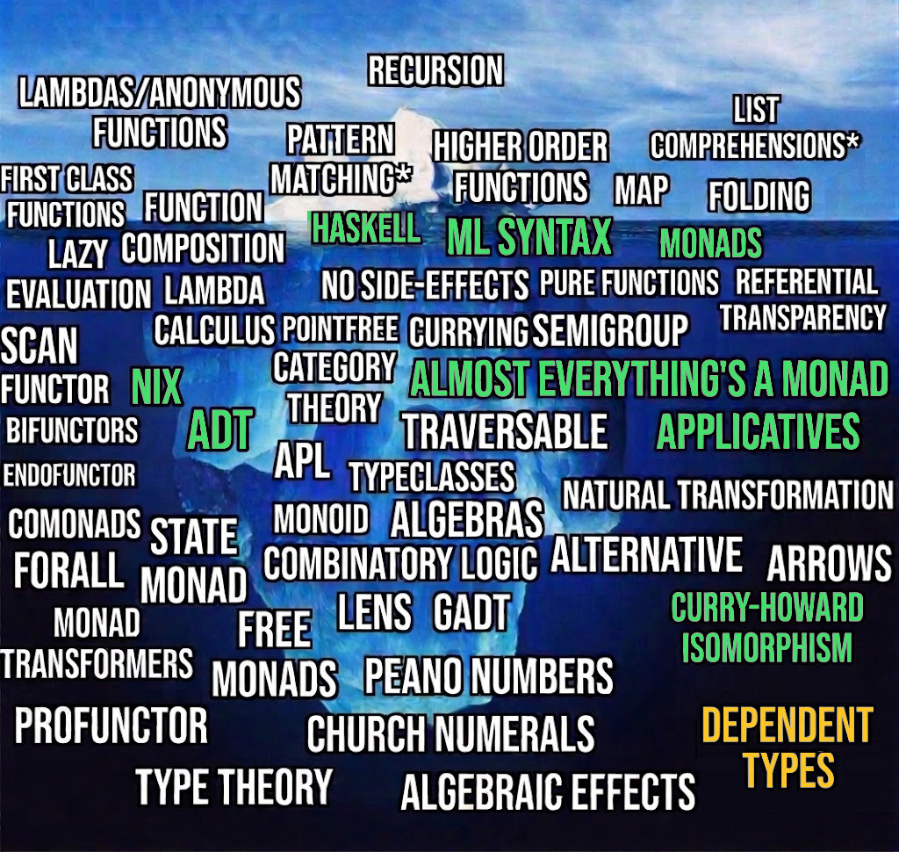
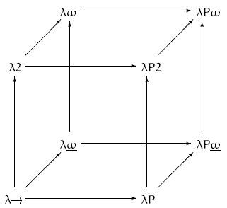
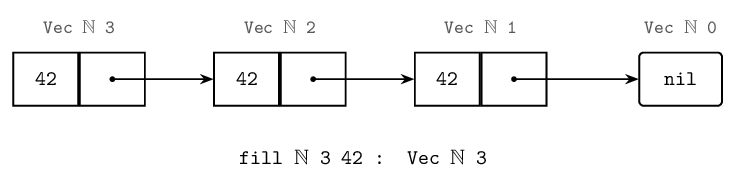
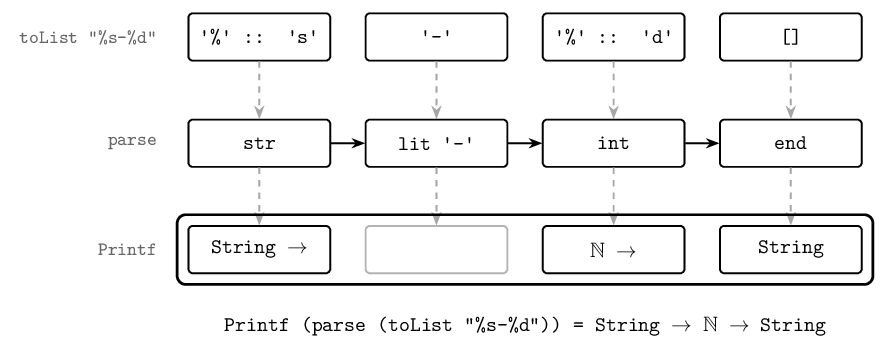
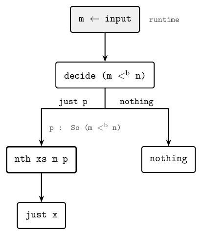
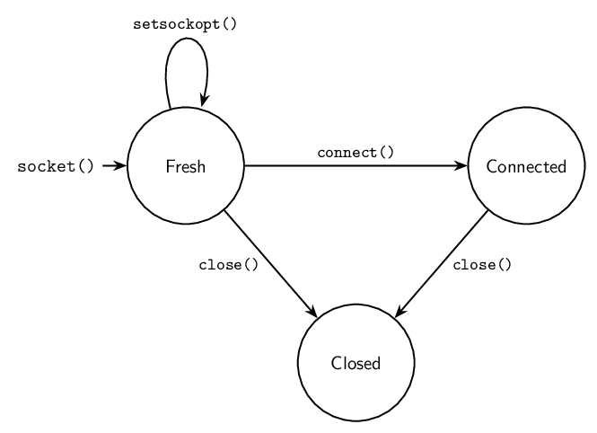

# Dependent types in programming

I've long wanted to grace the world with an article on dependent types.
And at last His Lordship found the time and inspiration.
How did I get here?
One day the functional iceberg caught my eye:



There were so many beautiful and incomprehensible words there
that I quickly concluded that until I figured out what they meant,
I would never be a real developer, and my life would be wasted.
And so, once I'd figured it out a tiny bit, I got itching to share.
I've already written about some of these, they're marked in green.
And now our topic is dependent types.

This topic is marked in yellow and sits at the very bottom of the iceberg.
Does that mean it's hard?
Probably yes.
And it's not even the idea itself that's hard, it can probably be stated in one sentence.
The difficulty comes more from the kaleidoscope of possibilities, and from the fact that intuition has nothing to lean on.
It's like templates in C++.
The idea seems simple and clear: substitute different values at compile time.
But... template metaprogramming...
Lucky are those who never had to.

So for most people this material will be hard.
But if you find it interesting and intriguing, yet hard, here's some advice.
In my opinion, it does no harm at all to simply skip the hard parts.
Roger Penrose wrote about this back in his book *The Road to Reality: A Complete Guide to the Laws of the Universe*.
Don't understand where a formula came from?
Skip it.
Details not entirely clear?
Skip it.
He even gave the example that chess held a place of honor in his family,
and Jonathan Penrose, Roger's younger brother, even
[beat](https://www.chessgames.com/perl/chessgame?gid=1105990)
the then world champion Mikhail Tal back in 1960...
Roger himself wasn't into chess, but sometimes leafed through books or magazines,
ignored the moves, and, in his view, still understood something.

I myself, while staying at my uncle's during the summer holidays,
read Donald Knuth at 11, about his MIX machine, about algorithms...
I understood little, but it was insanely interesting, maybe that's why I chose the developer's path.
So if it hooks you, read on, something will stick.
And if nope, the world is full of other interesting things.
You could learn TypeScript.


## The idea

If you ask what dependent types are, some may recall the lambda cube.
It's a classification of lambda calculi by three features: polymorphic types, type operators, and dependent types.
Each feature is a separate axis.
Wikipedia illustrates it like this:



That is, there is the basic typed lambda calculus, which we can extend:
let terms depend on types (polymorphism, λ2),
types on types (type operators, λω),
and types on terms (dependent types, λP).
They are all independent, so all possible in theory, but you can probably find points on this cube
without a single even slightly popular programming language.

Of the three axes, dependent types are the hardest, and they almost never appear alone,
they usually come together with the other two.
All the examples in this article will be in these λPω programming languages: Agda 2, Idris 2, and Lean 4.

Why three languages, and not one?
As a kid I programmed both in C and in Pascal, depending on what was installed on whatever computer I had access to.
I still think sticking to a single language is a bad idea.
When you see an elephant from different sides, the picture looks more whole.
The same construct can look like a strange ritual in one language, and in another it suddenly becomes clear why it's done that way.

So here's the order.
Agda is the most pedantic, it demands you spell everything out explicitly.
Idris is closest to the needs of regular programming, a lot of it is already hidden under the hood.
And Lean is the most lively, with the biggest community and ecosystem.
There's plenty of convenience there, though sometimes it feels like features get added faster than anyone manages to think them through...

But how useful are dependent types?
Some may know that most of modern mathematics can be written down using dependent types.
Here their usefulness is beyond any doubt.
A proof checked in Lean is today the highest level of mathematical reliability.

But how useful are they in programming?
I want to shout: "Very! Very!"
You may also notice that even Haskell is gradually evolving toward supporting dependent types.
But I'll limit myself to a more cautious: "It's quite an interesting concept."
Besides a general explanation, the article will illustrate this interestingness with three different practical examples specifically from programming,
without proving theorems.

So, what are dependent types?
Even in books devoted to languages with dependent types,
such as Type-Driven Development with Idris (Edwin Brady)
or Verified Functional Programming in Agda (Aaron Stump),
you won't find a separate definition.
Understanding comes by itself: you read about the language, do exercises, get used to it,
and somewhere along the way it dawns on you what it is.
I'll try to explain this idea somehow, without diving deep, for those who are curious.

Dependent types are a concept where, for any argument list,
be it a function call or the parameters of a new type,
the type of each next argument or the type of the result may depend on the values of the previous ones.

Sounds confusing, so I'll try to find some analogy.
Dependent types remind me most of C++ templates.
Let's look at the following code:

```cpp
template<class T, int N>
std::array<T, N> fill(const T& value) {
    std::array<T, N> result;
    for (int i=0; i<N; ++i)
        result[i] = value;
    return result;
}

auto a = fill<int, 3>(42);
auto b = fill<int, 5>(67);
```

Let's look at the template function `fill`.
Essentially it takes three arguments: `T`, the type of the array elements,
`N`, the number of elements, and a value of type `T`.
The function returns an array whose type depends on `N`, and `N` is a value, not a type.
That's exactly the idea of dependent types: a type can depend on a value.
There are just a few buts.

First, we don't need to separate
template (or generic) parameters from function arguments.
In languages with dependent types we just write `fill Int 3 42`.
Most of them use ML notation,
which is the equivalent of the usual `fill(Int, 3, 42)`.
The fact that the type of each next parameter can depend on the previous ones
is just the normal rule for an argument list.

Second, in C++ template parameters are compile-time constants,
whereas with dependent types the value is often known at compile time,
but that's not a requirement.

What are the closest analogues of this example in other languages?

Zig:

```zig
fn fill(comptime T: type, comptime N: usize, value: T) [N]T {
    var result: [N]T = undefined;
    for (0..N) |i|
        result[i] = value;
    return result;
}

const a = fill(i32, 3, 42);
const b = fill(i32, 5, 67);
```

Here the word `comptime` marks parameters
whose values must be known at compile time.
And the type `T` is passed just like the number `N`, without any angle brackets.
This is the closest syntax to what you find in programming languages
with dependent types.

Rust:

```rs
fn fill<T: Copy, const N: usize>(value: T) -> [T; N] {
    [value; N]
}

let a = fill::<i32, 3>(42);
let b = fill::<i32, 5>(67);
```

Here `Copy` means that values of type `T` can be copied.

But all these languages keep one restriction:
the value that goes into the type must be known at compile time.

Now on to programming languages with dependent types.
The corresponding code will look like this:

Agda:

```agda
fill : (A : Set) → (n : ℕ) → A → Vec A n
fill A zero    _ = []
fill A (suc n) x = x ∷ fill A n x

a : Vec ℕ 3
a = fill ℕ 3 42

b : Vec ℕ 5
b = fill ℕ 5 67
```

Idris:

```idris
fill : (a : Type) -> (n : Nat) -> a -> Vect n a
fill a Z     _ = []
fill a (S k) x = x :: fill a k x

a : Vect 3 Nat
a = fill Nat 3 42

b : Vect 5 Nat
b = fill Nat 5 67
```

Lean 4:

```lean
inductive Vec (α : Type) : Nat → Type where
  | nil  : Vec α 0
  | cons : α → Vec α n → Vec α (n + 1)

def fill : (α : Type) → (n : Nat) → α → Vec α n
  | _, 0,     _ => .nil
  | α, n + 1, x => .cons x (fill α n x)

def a : Vec Nat 3 := fill Nat 3 42
def b : Vec Nat 5 := fill Nat 5 67
```

The code is completely analogous, the difference is almost only in names.
The lines correspond to each other.

The first line is the function signature.
The type that contains types is called `Set` in Agda, and `Type` in Idris and Lean.
The type that contains natural numbers (and zero is a natural number) is ℕ in Agda,
and `Nat` in Idris and Lean.
The vector type, which is really a list, is `Vec` in Agda, `Vect` in Idris,
and in Lean I had to reinvent the wheel.
The built-in `Vector` in core is built on top of an array, and I didn't want to drag in `List.Vector` from Mathlib.
But you can see how the type is defined under the hood:
almost like a classic list, except we additionally count the number of elements.
The empty vector has length zero, and adding an element increases the length by one.



It's a type constructor that takes the element type and their count,
analogous to an array in interface, but not in memory layout.
And here Idris takes the count first and the type as the second parameter, unlike the others.

Next come pattern matching and the recursive call.
The second line is the case where we create a vector of zero elements.
Again zero is matched differently: `zero` in Agda, `Z` in Idris, and a plain 0 in Lean.
The empty vector is `[]` in Agda and Idris and the constructor `Vec.nil` in Lean.

The third line is the recursive call.
In Agda and Idris we use the list constructor as an operator:
`∷` in Agda and `::` in Idris, head on the left, tail on the right.
In Lean we call the constructor `Vec.cons` in function form, not as an operator.
The fact that the value of the parameter `n` is greater than zero is expressed through the successor constructor
(`suc` in Agda and `S` in Idris) and through a plain `n+1` in Lean.
Read it roughly like this: if a natural number can be written as `n+1`, make the recursive call.
`0` can't be written as `n+1`, because then `n` would have to be negative (minus one), and that's not a natural number.
All other natural numbers can be written as `n+1`, like `1=0+1`, `2=1+1`, `3=2+1`, ..., `96=95+1`.
Recursive calls usually use `n-1`, for example

```cpp
int factorial(int n) {
    return n == 0 ? 1 : n * factorial(n-1);
}
```

but here we write the parameter as `n+1`, so we just call with `n`.
In this branch the compiler knows that the result has the type of a vector of length `n+1`,
and the constructor takes a tail of length `n`, which is exactly what the recursive call gives.
So pattern matching on the ordinary value `n` simultaneously refines the function's result type.
That's exactly how dependent types work.

The difference in pattern matching syntax is, I think, clear without explanation.


## Implicit arguments

Those who have programmed in C++ know that template parameters don't have to be given explicitly.
Indeed, when we call `fill<MyObject, 7>(MyObject())`, the type MyObject is duplicated.
If we swap the parameters, we can write `fill<7>(MyObject())`,
and the compiler will figure out on its own that `T` is `MyObject`.

In languages with dependent types the same thing is done with curly braces `{}` in the signature.
Then the parameter becomes implicit, you don't need to pass it, the compiler infers it by itself.

Agda:

```
fill : {A : Set} → (n : ℕ) → A → Vec A n
fill zero    _ = []
fill (suc n) x = x ∷ fill n x

a : Vec ℕ 3
a = fill 3 42

b : Vec ℕ 5
b = fill 5 67
```

Idris:

```
fill : {a : Type} -> (n : Nat) -> a -> Vect n a
fill Z     _ = []
fill (S k) x = x :: fill k x

a : Vect 3 Nat
a = fill 3 42

b : Vect 5 Nat
b = fill 5 67
```

Lean:

```
inductive Vec (α : Type) : Nat → Type where
  | nil  : Vec α 0
  | cons : α → Vec α n → Vec α (n + 1)

def fill : {α : Type} → (n : Nat) → α → Vec α n
  | _, 0,     _ => .nil
  | _, n + 1, x => .cons x (fill n x)

def a : Vec Nat 3 := fill 3 42
def b : Vec Nat 5 := fill 5 67
```

In Agda and Idris the implicit argument disappears from pattern matching, while in Lean you still have to write `_` in its place.


## When a type is the result of computation

For many (but not for me) the main criterion of whether a programming language is functional is
whether you can easily create new functions on the fly, be it a lambda or a closure,
that is, how much functions are first-class citizens.
In programming languages with dependent types it naturally turns out that even types themselves become
first-class citizens, and we often pass them as values to functions.
When is this useful?

Sometimes in programming a situation arises where the type of a value depends on data.
For example, parsing JSON when the schema is known in advance.
Even when we're sure the schema has been validated and the field `age` is definitely an integer,
reading it without extra type conversion is hard without a specialized method like `readInt("age")`.

There are two mainstream ways around this.
Reflection, where class fields get attributes and the structure can be read at runtime just like ordinary data.
The other way is code generation, as in protobuf or Rust `serde`, which returns what you need.

We'll look at a slightly different example, namely the well-known C function `printf`.
The problem is quite similar: the argument types are computed from the format string.
Our task is to avoid situations where one type is passed but the format says another.

Often this is solved by adding sacred knowledge about format specifiers to the compiler.
But that limits us to exactly this format, and supporting a new one means patching the compiler.
Another option is for the compiler itself to parse the format and check it.
This requires advanced features like `consteval` in C++ and Rust macros.
Or the `comptime` specifier in Zig, which I decided to illustrate.
So, what will it look like?

First, let's add helper imports and functions.
The allocator is a Zig requirement, there is nothing by default, so a parameter of this type is usually a witness
that the function will allocate.
Plus converting a number to a string:

```zig
const std = @import("std");
const Allocator = std.mem.Allocator;
const ArrayList = std.ArrayList;

fn intToStr(buf: []u8, v: i32) []const u8 {
    return std.fmt.bufPrint(buf, "{d}", .{v}) catch unreachable;
}
```

Then some magic begins:

```zig
fn Args(comptime fmt: []const u8) type {
    var types: []const type = &.{};
    for (fmt, 0..) |c, i| {
        if (c != '%') continue;
        if (fmt[i + 1] == 'd') types = types ++ [_]type{i32};
        if (fmt[i + 1] == 's') types = types ++ [_]type{[]const u8};
    }
    return @Tuple(types);
}
```

This is a function that takes a format string and returns a tuple of the expected types.
We see that the argument `fmt` is marked `comptime`, which tells the compiler
that this value must be known at compile time.
You can't build a format dynamically and pass it to this function!

The loop itself is trivial: we walk through the format, and as soon as we find a percent sign,
we immediately add the corresponding type to the array of types.

`[_]type{i32}` is Zig's esoteric way of describing arrays.
So `[4]i32{1, 2, 3, 4}` is an array of integers of length 4, and `_` means "count the length yourself".


Next, the `cfmt` function itself:

```zig
fn cfmt(alloc: Allocator, comptime fmt: []const u8, args: Args(fmt)) ![]u8 {
    var out: ArrayList(u8) = .empty;

    comptime var k = 0;
    comptime var i = 0;
    inline while (i < fmt.len) : (i += 1) {
        if (fmt[i] != '%') {
            try out.append(alloc, fmt[i]);
            continue;
        }

        i += 1;

        if (fmt[i] == 'd') {
            var buf: [16]u8 = undefined; // "-2147483648"
            const s = intToStr(&buf, args[k]);
            try out.appendSlice(alloc, s);
        }

        if (fmt[i] == 's') {
            try out.appendSlice(alloc, args[k]);
        }

        k += 1;
    }

    return out.toOwnedSlice(alloc);
}
```

There aren't really any problems here, `args[k]` is the k-th argument, whose type has already been computed (`Args`) and is known to the compiler at a particular call.
`inline` forces the compiler to unroll the loop and simplify all the `if`s, so in each condition we'll see the argument's type.
The compiler simply discards branches with a false condition without type-checking them, so `appendSlice` never sees an `i32`.

For example, suppose there was a call with the format string `"a%sb%dc"`.
After performing all the steps, the compiler gets

```zig
Args(fmt) = [_]type{[]const u8, i32}
try out.append(alloc, 'a');
try out.appendSlice(alloc, args[0]); // type []const u8
try out.append(alloc, 'b');
var buf: [16]u8 = undefined;
const s = intToStr(&buf, args[1]); // type i32
try out.appendSlice(alloc, s);
try out.append(alloc, 'c');
```

All that's left is to check that everything works:

```zig
pub fn main() !void {
    const alloc = std.heap.page_allocator;

    const e = try cfmt(alloc, "Spin of %s equals %d/2", .{ "electron", 1 });
    defer alloc.free(e);
    std.debug.print("{s}\n", .{e});

    const d = try cfmt(alloc, "Spin of %s equals %d/2", .{ "delta baryon", 3 });
    defer alloc.free(d);
    std.debug.print("{s}\n", .{d});

    // _ = try cfmt(alloc, "Spin of %s equals %d/2", .{ 1, "proton" });   // compiler error
    // _ = try cfmt(alloc, "Spin of %s equals %d/2", .{"photon"});        // compiler error
}
```

Indeed, if we run it, we get


```
$ zig run fmt.zig
Spin of electron equals 1/2
Spin of delta baryon equals 3/2
```

If we uncomment the line with the proton, we get this error:

```
$ zig run fmt.zig
fmt.zig:59:54: error: expected type '[]const u8', found 'comptime_int'
    _ = try cfmt(alloc, "Spin of %s equals %d/2", .{ 1, "proton" });   // compiler error
                                                     ^
referenced by:
    callMain [inlined]: /nix/store/83qs3ksyjclr149vpxbaz1z18wvi9rms-zig-0.16.0/lib/zig/std/start.zig:698:59
    callMainWithArgs [inlined]: /nix/store/83qs3ksyjclr149vpxbaz1z18wvi9rms-zig-0.16.0/lib/zig/std/start.zig:638:20
    posixCallMainAndExit: /nix/store/83qs3ksyjclr149vpxbaz1z18wvi9rms-zig-0.16.0/lib/zig/std/start.zig:590:38
    2 reference(s) hidden; use '-freference-trace=5' to see all references
```

and if the one with the photon, this one:

```
$ zig run fmt.zig
fmt.zig:60:52: error: missing tuple field with index 1
    _ = try cfmt(alloc, "Spin of %s equals %d/2", .{"photon"});        // compiler error
                                                  ~^~~~~~~~~~
referenced by:
    callMain [inlined]: /nix/store/83qs3ksyjclr149vpxbaz1z18wvi9rms-zig-0.16.0/lib/zig/std/start.zig:698:59
    callMainWithArgs [inlined]: /nix/store/83qs3ksyjclr149vpxbaz1z18wvi9rms-zig-0.16.0/lib/zig/std/start.zig:638:20
    posixCallMainAndExit: /nix/store/83qs3ksyjclr149vpxbaz1z18wvi9rms-zig-0.16.0/lib/zig/std/start.zig:590:38
    2 reference(s) hidden; use '-freference-trace=5' to see all references
```

Time to see what dependent types have to offer.

### Agda

Let's see how programming languages with dependent types solve this problem.
We'll start with Agda.
But first, the main idea.
So, we have a format.
It would be nice to return for it a function that takes all the necessary arguments
and returns the formatted string.

That is, for the format `"%s%d"` it should return the type of a function
that takes a string (`String`), a number, let it be natural (`ℕ`),
and returns a `String`.
In ML syntax, such a function is written as
`String → ℕ → String`.

Since in programming languages with dependent types
a type is a value just like integers, this won't be a problem for us:

```agda
{-# OPTIONS --guardedness #-}

open import Agda.Builtin.String using () renaming (primShowNat to showℕ)
open import Data.Char.Base      using (Char)
open import Data.List           using (List; []; _∷_)
open import Data.Nat            using (ℕ)
open import Data.String         using (String; toList; fromChar; _++_)
open import Function            using (_$_)
open import IO                  using (Main; run; putStrLn; _>>_)

data Format : Set where
  int : Format → Format
  str : Format → Format
  lit : Char → Format → Format
  end : Format

parse : List Char → Format
parse ('%' ∷ 'd' ∷ cs) = int (parse cs)
parse ('%' ∷ 's' ∷ cs) = str (parse cs)
parse (c ∷ cs)         = lit c (parse cs)
parse []               = end

Printf : Format → Set
Printf (int f)   = ℕ → Printf f
Printf (str f)   = String → Printf f
Printf (lit _ f) = Printf f
Printf end       = String
```

The file starts with imports, including IO, which lets us write the main function and print lines.
Closely related to it is the first line, the option the code is compiled with.
Agda, like Lean, is used to build and check mathematical proofs,
where every function must terminate, but I/O lets you write infinite functions, for example,
waiting for user input forever. So Agda requires the `--guardedness` flag,
which allows such functions only under the compiler's special supervision,
and it may also conflict with some other flags.

Among the imports we also see rather strange `[]`, `_∷_`, `_++_`, `_$_`, `_>>_`.
These are just functions written as operators.
The `_` symbol (argument position) is the place where an expression can be inserted.
For example, `++` is string concatenation, and `_++_` means that the first argument goes to the left of `++` and the second to the right.

So, after the imports section, we have the definition of the parsed format string type,
which is essentially a type tag, plus a character in the case of a literal (`lit`),
and the rest of the format.

In the `parse` function you can see how elegantly parsing is done in functional programming languages.
Yes, I'm itching to talk about monadic parsers here, but that's definitely off topic for this article.
And the `Printf` function returns a `Set`, read: what we called `type` in Zig.
In this case, depending on the argument, it returns either `String` (end of format),
or the rest of the format (literal), or a function from `ℕ` or `String` to the rest of the format (`int` or `str`).

For example, if we have `"%s-%d"`, i.e. `[str, lit '-', int, end]`, the function can be traced like this:

```
Printf [str, lit '-', int, end] =
String → Printf [lit '-', int, end] =
String → Printf [int, end] =
String → ℕ →  Printf [end] =
String → ℕ → String
```



so for this format the result is a function that takes a `String` and an `ℕ` and returns a `String`.
If you know about currying, this is it.

Moving on:

```agda
render : (f : Format) → String → Printf f
render (int f)   acc = λ n → render f (acc ++ showℕ n)
render (str f)   acc = λ s → render f (acc ++ s)
render (lit c f) acc = render f (acc ++ fromChar c)
render end       acc = acc
```

This is where it gets interesting.
Let's again check how it works on our example format `"%s-%d"`.
First, the function signature.
`Printf (parse $ toList "%s-%d")` is `String → ℕ → String`, so the signature expands to

```
render : Format → String → String → ℕ → String
```

that is, a function that takes the parsed format, what has already been formatted
(an empty string on the first call), then the arguments, then the complete string.
So it's perfectly fine to call it as

```
render (parse $ toList "%s-%d") "prefix: " "test" 42
```

it should return `"prefix: test-42"`.
More precisely, so far we only see that the type check will pass.

And the function body simply walks through the format.
When we meet `%s` or `%d`, we return a function that appends the corresponding argument to `acc`.
This uses anonymous function syntax: `λ n → render f (acc ++ showℕ n)` is the same
as Python's `lambda n: render(f, acc + str(n))`.
When we meet an ordinary character, we append it right away.
When we reach `end`, we return everything we've accumulated.

Then it's just plumbing: put everything together and call it:

```agda
cfmt : (fmt : String) → Printf (parse (toList fmt))
cfmt fmt = render (parse (toList fmt)) ""

main : Main
main = run do
  putStrLn $ cfmt "Spin of %s equals %d/2" "electron" 1
  putStrLn $ cfmt "Spin of %s equals %d/2" "Ω baryon" 3
  -- putStrLn $ cfmt "Spin of %s equals %d/2" 1 "proton" -- compiler error
  -- putStrLn $ cfmt "Spin of %s equals %d/2" "photon"   -- compiler error
```

A successful run:

```
$ ./Fmt
Spin of electron equals 1/2
Spin of Ω baryon equals 3/2
```

Of course, let's pay our respects to the error messages.
The first commented-out line gives us

```
$ agda --compile Fmt.agda
Checking Fmt (/home/agda/labs/Fmt.agda).
/home/agda/labs/Fmt.agda:45.44-45: error: [UnequalTerms]
ℕ != String
when checking that the expression 1 has type String
```

and this is very clear, we mixed up the order and passed a number instead of a string,
which is what the message says.

The second line:

```
$ agda --compile Fmt.agda
Checking Fmt (/home/agda/labs/Fmt.agda).
/home/agda/labs/Fmt.agda:46.14-52: error: [UnequalTerms]
(ℕ → Printf (parse ('/' ∷ '2' ∷ []))) !=< String
when checking that the expression
cfmt "Spin of %s equals %d/2" "photon" has type String
```

this one is harder, we forgot an argument, so it turns out that our function expects a `String`,
but we return `ℕ → String`, which is what the compiler complains about.
Except it didn't carry the computation to the end: the string `"/2"`, the end of the format that we see,
contains no format characters, so it's just `String`.

### Idris

The Idris code will be completely analogous to what we saw in Agda.
The only difference is the syntax:

```idris
data Format = Number Format | Str Format | Lit Char Format | End

parse : List Char -> Format
parse ('%' :: 'd' :: cs) = Number (parse cs)
parse ('%' :: 's' :: cs) = Str (parse cs)
parse (c :: cs)          = Lit c (parse cs)
parse []                 = End

Printf : Format -> Type
Printf (Number f) = Nat -> Printf f
Printf (Str f)    = String -> Printf f
Printf (Lit _ f)  = Printf f
Printf End        = String

render : (f : Format) -> String -> Printf f
render (Number f) acc = \n => render f (acc ++ show n)
render (Str f)    acc = \s => render f (acc ++ s)
render (Lit c f)  acc = render f (acc ++ pack [c])
render End        acc = acc
```

First, we see that the imports are gone.
Agda went the way of "no imposed foundations":
the standard library is a separate package that you don't have to use,
and some libraries do just that, even defining natural numbers their own way.
So even the most basic usage has to be spelled out.

In this respect Idris, as a language primarily for programmers, went for more convenience.
We see that everything we need is already in the base library (`Prelude`),
so we can concentrate on writing code.

Second, the type is described more compactly:
instead of the full type of each constructor
you can simply list them separated by `|`.

We also don't see Unicode: instead of arrows we see the ASCII combination `->`,
instead of the Greek lambda we see a backslash `\`.
You can write this way in Agda too, but Unicode is common there and I like it better.

The technical part is also analogous:

```idris
cfmt : (fmt : String) -> Printf (parse (unpack fmt))
cfmt fmt = render (parse (unpack fmt)) ""

main : IO ()
main = do
  putStrLn $ cfmt "Spin of %s equals %d/2" "electron" 1
  putStrLn $ cfmt "Spin of %s equals %d/2" "Ω baryon" 3
  -- putStrLn $ cfmt "Spin of %s equals %d/2" 1 "proton" -- compiler error
  -- putStrLn $ cfmt "Spin of %s equals %d/2" "photon"   -- compiler error
```

Let's run it, everything works:

```
$ idris2 -o Fmt Fmt.idr
$ build/exec/Fmt
Spin of electron equals 1/2
Spin of Ω baryon equals 3/2
```

All that's left are the error messages.
The first:

```
$ idris2 -o Fmt Fmt.idr
Error: While processing right hand side of main. Can't find an implementation for Num String.

Fmt:28:44--28:45
 24 | main : IO ()
 25 | main = do
 26 |   putStrLn $ cfmt "Spin of %s equals %d/2" "electron" 1
 27 |   putStrLn $ cfmt "Spin of %s equals %d/2" "Ω baryon" 3
 28 |   putStrLn $ cfmt "Spin of %s equals %d/2" 1 "proton" -- compiler error
                                                 ^

Warning: compiling hole Main.main
```

Here we swapped the arguments, a number instead of a string and vice versa.
So the compiler complains that it couldn't find a `Num` implementation for `String`.
`Num` is the interface for numeric types.
The thing is, in Idris a numeric literal has no fixed type,
`1` is really `fromInteger 1`, and it can become `Nat`, `Int`, `Double`
or any other type that has a `Num` implementation.
But you can't make a `String` out of it.

The second:

```
$ idris2 -o Fmt Fmt.idr
Error: While processing right hand side of main. When unifying:
    Nat -> Printf (parse [assert_total (prim__strIndex (fromString "Spin of %s equals %d/2") (prim__cast_IntegerInt (natToInteger (assert_total (integerToNat 20))))),
                          assert_total (prim__strIndex (fromString "Spin of %s equals %d/2") (prim__cast_IntegerInt (natToInteger (assert_total (integerToNat 21)))))])
and:
    String
Mismatch between: Nat -> Printf (parse [assert_total (prim__strIndex (fromString "Spin of %s equals %d/2") (prim__cast_IntegerInt (natToInteger (assert_total (integerToNat 20))))),
                                        assert_total (prim__strIndex (fromString "Spin of %s equals %d/2") (prim__cast_IntegerInt (natToInteger (assert_total (integerToNat 21)))))]) and String.

Fmt:29:14--29:52
 25 | main = do
 26 |   putStrLn $ cfmt "Spin of %s equals %d/2" "electron" 1
 27 |   putStrLn $ cfmt "Spin of %s equals %d/2" "Ω baryon" 3
 28 |   -- putStrLn $ cfmt "Spin of %s equals %d/2" 1 "proton" -- compiler error
 29 |   putStrLn $ cfmt "Spin of %s equals %d/2" "photon"   -- compiler error
                   ^^^^^^^^^^^^^^^^^^^^^^^^^^^^^^^^^^^^^^

Warning: compiling hole Main.main
```

The message here is similar to what we saw in Agda, except that while computing the format the compiler shows the guts of `unpack`,
the function we used to convert the string into a list of characters.


### Lean

The base Lean code is almost the same:

```lean
inductive Format where
  | int : Format → Format
  | str : Format → Format
  | lit : Char → Format → Format
  | done : Format

def parse : List Char → Format
  | '%' :: 'd' :: cs => .int (parse cs)
  | '%' :: 's' :: cs => .str (parse cs)
  | c :: cs          => .lit c (parse cs)
  | []               => .done

def Printf : Format → Type
  | .int f   => Nat → Printf f
  | .str f   => String → Printf f
  | .lit _ f => Printf f
  | .done    => String

def render : (f : Format) → String → Printf f
  | .int f,   acc => fun n => render f (acc ++ toString n)
  | .str f,   acc => fun s => render f (acc ++ s)
  | .lit c f, acc => render f (acc.push c)
  | .done,    acc => acc
```

Yes, `end` is now a reserved word, so it's replaced with `done`.
The type description is like in Agda.
The code is almost identical in all the languages.

But further on, in the technical part, a few points came up:

```lean
def cfmt (fmt : String) : Printf (parse fmt.toList) :=
  render (parse fmt.toList) ""

def putStrLn (s : String) : IO Unit := IO.println s

def main : IO Unit := do
  putStrLn $ cfmt "Spin of %s equals %d/2" "electron" 1
  putStrLn $ cfmt "Spin of %s equals %d/2" "Ω baryon" 3
  -- putStrLn $ cfmt "Spin of %s equals %d/2" 1 "proton" -- compiler error
  -- putStrLn $ cfmt "Spin of %s equals %d/2" "photon"   -- compiler error
```

The first point is the `putStrLn` function, which I had to write myself.
The standard `IO.println` accepts a value of any type that has an implementation of the `ToString` interface.
But when looking for this implementation, the compiler doesn't evaluate the type `Printf (parse ...)`,
so it doesn't realize that it's actually a plain `String`, and fails with an error.

This runs and works:

```
$ lake env lean --run Fmt.lean
Spin of electron equals 1/2
Spin of Ω baryon equals 3/2
```

The errors are more interesting.
If we uncomment the first line, we get

```
$ lake lean Fmt.lean
Fmt.lean:33:43: error(lean.synthInstanceFailed): failed to synthesize instance of type class
  OfNat String 1
numerals are polymorphic in Lean, but the numeral `1` cannot be used in a context where the expected type is
  String
due to the absence of the instance above

Hint: Type class instance resolution failures can be inspected with the `set_option trace.Meta.synthInstance true` command.
```

In principle it's clear: we read the number `1` where a `String` was expected.
But the second one...

```
$ lake lean Fmt.lean
Fmt.lean:34:13: error: Application type mismatch: The argument
  cfmt "Spin of %s equals %d/2" "photon"
has type
  Printf
    (parse
      (((((((((((([].concat
                                                    {
                                                      val :=
                                                        "Spin of %s equals %d/2".toByteArray[0 +
...................................
About 2400 lines omitted
...................................
                            ⋯).concat
                        ⋯).concat
                    ⋯).concat
                ⋯).concat
            ⋯).concat
        ⋯))
but is expected to have type
  String
in the application
  putStrLn (cfmt "Spin of %s equals %d/2" "photon")
```

This is the second interesting point.
Yes, it's easy to see that the type `String` is expected,
but what was passed instead...
Just a huge trace of the library function that converts a UTF-8 encoded byte array into a list of characters.

One more thing.
Can we call `cfmt` with a format that came in at runtime?
Yes, we can, but then we have to somehow convince the compiler that the format and the argument types match each other.
This isn't very easy, so we'll skip the details.
I'll only say that the ideas are similar to those in the next section.


## Contracts

Very often the first thing a function does when called is check its arguments.
If the arguments are invalid, it either returns an error code: C (`errno`, `EINVAL`), Go (`(value, error)`), Rust (`Result`/`Option`),
or throws an exception: C++ (`std::invalid_argument`), Java (`IllegalArgumentException`), C# (`ArgumentException`), ...
In Python there's no single exception, instead there are several possible ones: `TypeError`, `ValueError`, `IndexError`.

This seems so natural that it's hard to even imagine alternatives.
Often, when argument checking can be expensive, a separate function without the check is written alongside.
For example, the Linux kernel has a code convention where a `__` prefix at the start of a function name means it's a low-level version, and meeting the preconditions is the caller's responsibility.
Other languages use other naming: Rust has the `_unchecked` suffix, Swift the `unsafe` prefix, and so on.

But there is another way.
It became popular thanks to the Eiffel programming language.
That's where its name comes from: contracts.
The idea is to describe the conditions imposed on the arguments explicitly.
Instead of the check hiding somewhere in the function body or resting on an unspoken agreement,
it becomes part of the very contract between the caller and the function.
What the caller guarantees is called a precondition.
And what the function guarantees is called a postcondition.

For example, when we call a function that returns the n-th element of an array,
the precondition is that the index n is within the bounds of the array.
And for a sorting function the postcondition is that the result is sorted and contains the same elements as the input array.

If the condition is described formally, not just in a comment or documentation, it gives the compiler more freedom.
The condition can be checked like an ordinary `assert` at runtime,
or the check can be dropped altogether if the context already shows that it always holds.
Or you can try to prove it mathematically using a special program called a solver.
That's exactly how it works in Ada/SPARK, where contracts are checked by an SMT solver,
which proves that the condition holds for all possible inputs, rather than just checking it during one particular run.

But this hasn't reached the masses yet.
Relatively fresh news: C++26 adopted proposal P2900, which adds contracts directly to the standard.
It looks like this, I think the syntax is clear from context.

```cpp
int nth(const std::vector<int>& v, size_t n)
    pre(n < v.size())
{
    return v[n];
}

void sort(std::vector<int>& v)
    post(std::is_sorted(v.begin(), v.end()))
{
    std::sort(v.begin(), v.end());
}
```

Nobody has delivered SMT solvers to the C++ standard yet, so for now flags let you choose between four behaviors:
with (1) `ignore` no check happens at all, read: a disabled `assert`,
with (2) `observe` the condition is checked, and if it fails, a handler is called, after which execution continues,
with (3) `enforce` the condition is also checked, on violation the handler is called, and then the program terminates,
with (4) `quick_enforce` the program terminates immediately on violation, without a handler, read: an analogue of `abort`.

In other widely used programming languages, as of now, this is either experimental or done by external tools.

And what answer do programming languages with dependent types give us?
A small trick lets us naturally add contracts to the function signature.
Let's start with our `nth` example:

```agda
data So : Bool → Set where
  oh : So true

nth : {n : ℕ} (v : Vec String n) (m' : ℕ) → So (m' <ᵇ n) → String
nth (x ∷ _)  zero    _ = x
nth (_ ∷ xs) (suc m) p = nth xs m p
```

Let's try to take this code apart.
We should start with the `nth` function, which consists of three lines.
The first is the function signature: what types it takes and what it returns.
The second and third are its body.

What's interesting in the signature?
Let's go through the parameters.
First comes `n`, obviously the length of the vector of strings.
Next `v`, the vector of strings of length `n` itself.
Then comes `m'`, the index of the element we want to get.
It's a bit strange that the apostrophe is part of the name, but it's handy: it reads as "m prime", say hi to math.
Then comes some alien gibberish, though the eye can spot the familiar pattern we need, `m' < n`, wrapped in mumbo jumbo.
We'll take it apart in detail later.
The function, as expected, returns a String.

The implementation is typical for functional programming,
essentially it's the equivalent of the following Python code:

```python
def nth(lst, m):
    x, *xs = lst
    if m == 0:
        return x
    else:
        return nth(xs, m-1)
```

`x` is the first element of the vector,
`xs` is the rest of the elements, a vector whose length is one less than that of `v`.
Essentially, in pattern matching we handle two alternatives: either the parameter `m'` equals zero (`zero`),
that's line two.
Then we just return the first element.
Or the parameter `m'` is not zero, line three, and then it can be written as `m+1`,
or the next element (successor) after `m`, or `suc m`.
Hence `m=m'-1`, which is what gets passed recursively.
We skip the magic with the parameter `p` again for now.

What happens when we pass an empty vector?
Haskell in this case, depending on the options, will either crash at runtime,
or at compile time ask us not to forget this case.
Agda is more interesting here: it requires handling all possible cases.
But this code compiles.
What's going on???

That's exactly where the `So` magic kicks in.
If the vector `v` is empty, then its length `n` is zero, there's no other way.
And there's no natural number `m'` less than zero.
So you can't pass an empty vector.
So this case can be left out.
By the way, you can write it out too.
It would look like

```agda
nth [] _ ()
```

this is the so-called absurd pattern.
Notice that in place of the magic parameter `p` there is `()`.
You can read it as a hint that the empty vector is absurd, impossible, precisely because of the argument `p`.
But when the compiler can figure it out on its own, it's usually not written.

So, now we understand everything except the `So` magic.
To be honest, the name is very metaphorical, people without a sense of humor would call this type `IsTrue` or `StaticAssert`.
Because its job is quite simple: check at compile time that a certain expression evaluates to `true`.
We already wrote above about the analogy between dependent types and C++ templates.
Once upon a time, in ancient times, when the C++ standard had no `static_assert`, it was implemented through metaprogramming.
`static_assert` was a type parameterized by a `bool` value, but with a specialization defined only for `true`.
So when `false` got in there, you got a wall of text saying that the required template specialization was not defined.

Here it's almost one to one.
The type `So` is parameterized by a `Bool` value, but has only one constructor `oh`, whose type is fixed as `So true`.
When the compiler sees `oh` as the last argument, it sees that the type of `oh` is `So true`,
and tries to unify it with what it sees in the signature, namely `So (m' <ᵇ n)`.
From there it starts checking that `m' <ᵇ n` must equal `true`, and that is our precondition!

But why such strange names?
Let's look at the line `oh : So true`.
It just begs to be read as "Oh! So true".
That's exactly why these strange names were chosen.
As a bonus, these metaphorical identifiers are short and hardly clutter the code.
Conor McBride started using this trick in his lectures on the Epigram programming language,
and then it somehow caught on.

So, in the end, if the compiler can convince itself that `m' <ᵇ n`, the code compiles.
If not, it fails with an error.
The following lines illustrate this:

```agda
example : Vec String 5
example = "a" ∷ "b" ∷ "c" ∷ "d" ∷ "e" ∷ []

third : String
third = nth example 2 oh

-- Compiler error
-- seventh : String
-- seventh = nth example 6 oh
```

The function `third` compiles fine because `2 <ᵇ 5`.
But if we uncomment `seventh`, we get a compilation error:

```
$ agda Contracts.agda
Checking Contracts (/home/agda/labs/Contracts.agda).
/home/agda/labs/Contracts.agda:26.25-27: error: [UnequalTerms]
true != false of type Bool
when checking that the expression oh has type So (6 <ᵇ 5)
```

Agda complains that true is not false.
Indeed, `oh` is `So true`, and `So (6 <ᵇ 5)` is `So false`.
They are incompatible.
Our static assert, the precondition, fired!

You may be wondering why it says `<ᵇ` and not just `<`.
Mathematically, "strictly less than" is an example of a relation.
We take two objects, in this example two natural numbers,
and say "yes" or "no": is it true that the first number is less than the second or not.

Now, you can approach relations from two sides.
First, we can write a function that takes two objects and returns `true` or `false`
depending on whether we say "yes" or "no".
`<ᵇ` is such a function, and the superscript ᵇ refers to the Bool type: the result is a boolean.

But sometimes this is inconvenient.
The classic example is the Prolog programming language, the definition of an ancestor.
Everyone is an ancestor of themselves, and also an ancestor of the children of their descendants.

```prolog
ancestor(X, X).
ancestor(X, Y) :- parent(Z, Y), ancestor(X, Z).
```

Intuitively it can be understood like this: everyone is a descendant of themselves.
And a child of a descendant is also a descendant.

Yes, you could write a function that takes two people and searches the database to see whether one is a descendant of the other.
But that's complicated.
There's another approach: want to prove that Ada is a descendant of Pascal?
Then give a chain of people that starts with Blaise Pascal, ends with Ada Lovelace,
and where each next one is a son or daughter of the previous person.

This way, a relation becomes a data type!
One that contains various proofs that the relation holds.
For example, the sequence Anakin Skywalker → Leia Organa → Kylo Ren
is a proof that Kylo Ren is a descendant of Anakin Skywalker.
Or the chain 2 → 3 → 4 → 5 is a proof that two is less than five, i.e., it's a value of type `2 < 5`.

But if we consider the type `6 < 5`, it contains no values at all.
Because the corresponding chain, where each next value is one greater than the previous, starting at 6 and ending at 5, is impossible to build.
An empty type, a.k.a. `Void`.
So, since Agda is a mathematical language, `<` without the superscript ᵇ means exactly the data type, not the function.

That's all well and good, but what if the user enters the index themselves?
How do we call `nth` then?
How do we satisfy `So`???
The answer is the following code, where the `Maybe` type appears.
It has two cases, `just x` (there is a value) or `nothing` (there is no value),
the equivalent of `Nullable<T>` in C#, `Option<T>` in Rust, `Optional<T>` in Java, or `Optional[T]` in Python.

```agda
decide : (b : Bool) → Maybe (So b)
decide true  = just oh
decide false = nothing

nth? : {n : ℕ} (xs : Vec String n) (m : ℕ) → Maybe String
nth? {n} xs m with decide (m <ᵇ n)
... | just p  = just $ nth xs m p
... | nothing = nothing
```

Yes, a bit of magic...
First, `just $ nth xs m p`.
Everyone knows that functional languages have a problem with parentheses.
Hackers once stole the last megabyte of Lisp code, but it turned out to be just closing parentheses!
So `$` is a way to cure this problem.
You can read it as parentheses from this point to the end.
That is, `just (nth xs m p)`.
Similarly, `putStrLn $ showMaybe $ nth? example 2`
is the equivalent of `putStrLn (showMaybe (nth? example 2))`.

Next, the question mark is part of the identifier, it's a convention, a way to signal that the function returns an optional value.

Now to the point.
First, our precondition `p`, which contained the proof that the index is within the vector's bounds, has disappeared from the arguments.
Second, the result type changed from `String` to `Maybe String`.
But under the hood `nth` is called!

The idea is that instead of demanding a proof of `m <ᵇ n` from the caller,
we can compute this condition ourselves.
If it's `true`, here's your proof!
If it's `false`, sorry, no proof.
`decide` is exactly what turns a `Bool` value into a possible proof.

Then just a small pattern match on the result of `decide`.
If we got `just p`, we call the familiar `nth` with the proof `p` handed to us.
If `nothing`, then there's no proof, and with it no result, so we return `nothing` directly.

And this is where the main difference from `comptime` in Zig or C++ templates shows up.
There the value that goes into the type must be known at compile time, while here the index `m` can come from anywhere: the keyboard, a file, the network.
The compiler doesn't know what the index is, so it forces us to add a check.



All that's left is to show that everything works!
Here's the code that prints the results, I hope you've gotten used to Agda syntax by now.

```agda
showMaybe : Maybe String → String
showMaybe (just s) = "just " ++ s
showMaybe nothing  = "nothing"

main : Main
main = run do
  putStrLn third
  -- putStrLn seventh
  putStrLn $ showMaybe $ nth? example 2
  putStrLn $ showMaybe $ nth? example 7
```

Moving on to Idris.
The differences are small.

At the start you can see that the type `So` has moved to the standard library:

```idris
import Data.So
```

Next, the `nth` function has changed:

```idris
nth : (v : Vect n String) -> (m : Nat) -> So (m < n) -> String
nth []        Z     p = absurd p
nth []        (S _) p = absurd p
nth (x :: _)  Z     _ = x
nth (_ :: xs) (S k) p = nth xs k p
```

Two changes here. The implicit parameter `n` has disappeared from the signature.
This is an Idris feature: if a variable in the signature is not declared, but its type can be inferred,
it becomes an implicit variable.
Here `n` is not declared at all, and from `Vect n String` it's easy to see that `n` can only be of type `Nat`,
so this is exactly that case.

Next, two extra lines appeared.
Because of small differences in the definition of the `<` operation, the Idris compiler can't figure out on its own that the case
where `nth` is called with an empty vector can never happen.
So I had to add two extra lines for it.

Let's look at the right-hand side.
It sounds as metaphorical as it gets: the expression `p` becomes absurd!
And what is our `p`?
It's `So (m < n)`.
What do we know about it?
If the vector `v` is empty, then `n` must be zero.
So we have `So (m < 0)`.
Which, of course, doesn't hold for any natural `m`, because numbers less than zero simply don't exist.

Yes, we had to make the compiler's life a bit easier:
we split `m` into two constructors, and only then could it peek into the definition of the `<` operation
and understand that it is always `False`, and `So False` cannot be constructed at all...
Let's stop for a moment...
The function takes an argument that is impossible to construct.
That means that if we reached this line, we constructed something impossible to construct.
In other words, it's `assert(false)`, only proven by the compiler.
And if so, we are guaranteed never to get here, and this branch will never execute.

Also, `<` is the analogue of Agda's `<ᵇ`, and the type `LT` is the analogue of the mathematical definition of the relation.

Next...

```idris
example : Vect 5 String
example = "a" :: "b" :: "c" :: "d" :: "e" :: []

third : String
third = nth example 2 Oh

-- Compiler error
-- seventh : String
-- seventh = nth example 6 Oh
```

Only the syntax is different here, next...

```idris
nth' : {n : Nat} -> (xs : Vect n String) -> (m : Nat) -> Maybe String
nth' {n} xs m = case choose (m < n) of
  Left  p => Just (nth xs m p)
  Right _ => Nothing
```

Everything is analogous here, `decide` is replaced by the library `choose`.
We also have to declare the variable `n` explicitly, because in the function body we compute `m < n` ourselves, and implicit parameters that the compiler inferred on its own are not available at runtime.
Next...


```idris
main : IO ()
main = do
  putStrLn third
  -- putStrLn seventh
  putStrLn $ show $ nth' example 2
  putStrLn $ show $ nth' example 7
```

Here we did without `showMaybe`, because the compiler itself knows how to print it.

And the most interesting part is the compilation error text when we uncomment `seventh`:

```
$ idris2 -o Contracts Contracts.idr
Error: While processing right hand side of seventh. When unifying:
    True
and:
    False
Mismatch between: True and False.

Contracts:18:25--18:27
 14 | third = nth example 2 Oh
 15 |
 16 | -- Compiler error
 17 | seventh : String
 18 | seventh = nth example 6 Oh
                              ^^

Warning: compiling hole Main.seventh
```

Almost the same message.

Now let's move on to the Lean version.

```lean
inductive Vec (α : Type) : Nat → Type where
  | nil  : Vec α 0
  | cons : α → Vec α n → Vec α (n + 1)

def nth : (v : Vec String n) → (m : Nat) → Nat.blt m n → String
  | .cons x _,  0,     _ => x
  | .cons _ xs, k + 1, h => nth xs k h
```

Again we have to define our own `Vec` type.
`Nat.blt` means exactly the comparison function, the analogue of Agda's `<ᵇ`, while the plain less-than sign means the type.
We also see that Lean figured out the absurd cases by itself, without writing them explicitly (for writing them explicitly there's `nomatch`).

We also see that the `So` wrapper is gone, because Lean automatically treats `Bool` expressions in arguments as an analogue of `So`.
A bit of syntactic sugar.


```lean
def sample : Vec String 5 :=
  .cons "a" (.cons "b" (.cons "c" (.cons "d" (.cons "e" .nil))))

def third : String := nth sample 2 rfl

-- Compiler error
-- def seventh : String := nth sample 6 rfl
```

The list notation here may not be very convenient, you can redefine operators, but that's not the point.
Instead of our `oh` there is `rfl`, short for reflexivity,
which is used very often in proofs.
It means the same thing: compute and make sure the expression is `true`.
Next...

```lean
def nth? (v : Vec String n) (m : Nat) : Option String :=
  if h : Nat.blt m n
    then some (nth v m h)
    else none
```

Here we see more syntactic sugar.
Instead of `decide` or `choose`, which return an optional proof when the condition holds,
in Lean you can simply give a name to the fact in the `if` statement, and it will be available in the `then` branch.
This fact can then be passed as an argument, which is what we do when calling `nth`.

And printing stays almost the same as in Idris:

```lean
def main : IO Unit := do
  IO.println third
  -- IO.println seventh
  IO.println $ toString $ nth? sample 2
  IO.println $ toString $ nth? sample 7
```

And what will the error be?
```
$ lean Contracts.lean
/home/lean/labs/Contracts.lean:15:37: error: Application type mismatch: The argument
  rfl
has type
  ?m.5 = ?m.5
but is expected to have type
  Nat.blt 6 5 = true
in the application
  nth sample 6 ⋯
```

Here we see a small nuance related to how `rfl` is defined.
It's no longer a boolean expression that must equal `true`, but the equality of an expression to itself.
And what's expected is an equality where the right-hand side `true` comes from our syntactic sugar, and the left-hand side is our expression.
Next we see `Nat.blt 6 5`, which is our `6 < 5`, and the complaint that it's by no means `true`,
just as we interpreted `So` in Agda and Idris, only here the compiler does it itself, behind the scenes.

That's all for contracts for now.


## Typestate

Anyone who has done programming has dealt with object lifecycles.
Objects change their state, and each state has its own set of available operations.
Take, for example, a client network socket.
After it's created with a `socket()` call,
we can configure it with `setsockopt()` calls,
for example set the buffer sizes `SO_RCVBUF` and `SO_SNDBUF`.
Then we call `connect()`, after which these settings are silently ignored.
Calling `connect()` again is also an error.
And finally `close()`.
And a second `close()` can close someone else's freshly opened descriptor.

But people make mistakes, so it would be nice for the compiler to check our code and make sure there are no such errors.
As you can guess, dependent types can do this job.

The first question: how relevant is this at all?
To answer, we need to look at other languages: has anything appeared there that addresses this?
And the answer is: it has indeed!
Clang has little-known attributes `callable_when` and `set_typestate`, checked by the `-Wconsumed` analysis.
For Java there are external annotation-based checkers, for example Mungo.
In TypeScript this is achieved through a generic parameter and a typed this.
Swift got noncopyable types in version 5.9, on which this can be built
In Ada/SPARK it's done through contracts and an SMT solver.
But we'll compare with Rust, where this is implemented using typestate.
So things are moving, somehow.

So, what do we want?
Let's make a small table: what states the socket has and what can be done with it in each of them.

| State     | `setsockopt()` | `connect()` | `close()` |
|-----------|----------------|-------------|-----------|
| Fresh     | Fresh          | Connected   | Closed    |
| Connected | ✗              | ✗           | Closed    |
| Closed    | ✗              | ✗           | ✗         |

The same thing, but as a state graph, where arrows are allowed transitions.



For the pedants: I know that life is messy and the table is simplified.
For example, some options can be changed even after `connect()`, and a real socket is generally more complex.
Also, functions can return errors, but...
our article is about the capabilities of dependent types, not the details of sockets.

### Rust

```rs
struct Fresh;
struct Connected;
struct Closed;

struct Socket<S> {
    state: S,
}

impl<S> Socket<S> {
    fn state_name(&self) -> &'static str {
        std::any::type_name_of_val(&self.state)
    }
}

fn socket() -> Socket<Fresh> {
    println!("socket()");
    Socket { state: Fresh }
}

impl Socket<Fresh> {
    fn set_option(&mut self, name: &str) {
        println!("setsockopt({name}) state={}", self.state_name());
    }

    fn connect(self) -> Socket<Connected> {
        println!("connect() state={}", self.state_name());
        Socket { state: Connected }
    }
}

trait Open {}
impl Open for Fresh {}
impl Open for Connected {}

impl<S: Open> Socket<S> {
    fn close(self) -> Socket<Closed> {
        println!("close() state={}", self.state_name());
        Socket { state: Closed }
    }
}

fn main() {
    let mut s = socket();
    s.set_option("SO_RCVBUF");
    s.set_option("SO_SNDBUF");

    let s = s.connect();
    // s.set_option("SO_RCVBUF");  // compiler error
    // s.connect();                // compiler error

    let s = s.close();
    println!("final state={}", s.state_name());
    // s.close();                  // compiler error
}
```

So what do we see here?
First, three states: `Fresh`, `Connected`, `Closed`.
Second, the `Socket` type, parameterized by state.
Next, the socket constructor, which returns a new socket in the `Fresh` state.
Then we simply write method implementations for each state separately.
And if we need a method shared by several states, we use a somewhat esoteric hack.
Yes, when an object changes state its type changes, so we need to reassign,
luckily in Rust you can shadow variable names.

If we uncomment the line

```rs
s.close();                  // compiler error
```

we get an error:

```
$ cargo run --bin Typestates
Compiling labs v0.1.0 (/home/rust/labs)
error[E0599]: the method `close` exists for struct `Socket<Closed>`, but its trait bounds were not satisfied
--> src/bin/Typestates.rs:53:7
|
3 | struct Closed;
| ------------- doesn't satisfy `Closed: Open`
4 |
5 | struct Socket<S> {
| ---------------- method `close` not found for this struct
...
53 |     s.close();                  // compiler error
|       ^^^^^ method cannot be called on `Socket<Closed>` due to unsatisfied trait bounds
|
note: there's an earlier shadowed binding `s` of type `Socket<Fresh>` that has method `close` available
--> src/bin/Typestates.rs:43:9
|
43 |     let mut s = socket();
|         ^^^^^ `s` of type `Socket<Fresh>` that has method `close` defined earlier here
...
51 |     let s = s.close();
|         - earlier `s` shadowed here with type `Socket<Closed>`
note: trait bound `Closed: Open` was not satisfied
--> src/bin/Typestates.rs:35:9
|
35 | impl<S: Open> Socket<S> {
|         ^^^^  ---------
|         |
|         unsatisfied trait bound introduced here
note: the trait `Open` must be implemented
--> src/bin/Typestates.rs:31:1
|
31 | trait Open {}
| ^^^^^^^^^^

For more information about this error, try `rustc --explain E0599`.
error: could not compile `labs` (bin "Typestates") due to 1 previous error
```

`close` is defined only for states with `Open`, and `Closed` doesn't implement this trait,
so the compiler refuses to call the method, we won't go into the details of its reasoning.

### Agda

This looks quite interesting.
What answer will dependent types give us here?
Let's start with Agda:

```agda
{-# OPTIONS --guardedness #-}

open import Data.Bool   using (Bool ; true ; false)
open import Data.String using (String ; _++_ ; unlines)
open import Data.List   using (List ; [_] ; _∷ʳ_)
open import Function    using (_$_)
open import IO          using (Main ; run ; putStrLn)

data State : Set where
  fresh connected closed : State

data Op : Set where
  setOption : String → Op
  connect close : Op

show : Op → String
show (setOption n) = "setsockopt(" ++ n ++ ")"
show connect       = "connect()"
show close         = "close()"

data Result : Set where
  accepted : State → Result
  rejected : Result

transition : State → Op → Result
transition fresh  (setOption _) = accepted fresh
transition fresh  connect       = accepted connected
transition closed close         = rejected
transition _      close         = accepted closed
transition _      _             = rejected

allowed : State → Op → Bool
allowed s op with transition s op
... | accepted _ = true
... | rejected   = false

step : State → Op → State
step s op with transition s op
... | accepted s′ = s′
... | rejected    = s

record Socket (s : State) : Set where
  constructor mkSocket
  field
    history : List String

socket : Socket fresh
socket = mkSocket [ "socket()" ]

data So : Bool → Set where
  oh : So true

exec : {s : State} (op : Op) → Socket s → So (allowed s op) → Socket (step s op)
exec op (mkSocket h) _ = mkSocket (h ∷ʳ show op)

example : Socket closed
example = do
  let s₁ = exec (setOption "SO_RCVBUF") socket oh
  let s₂ = exec (setOption "SO_SNDBUF") s₁ oh
  let s₃ = exec connect s₂ oh
  -- let s₄ = exec connect s₃ oh   -- compiler error
  exec close s₃ oh

main : Main
main = run $ putStrLn $ unlines $ Socket.history example
```

Looks cool!
Yes, this is the analogue of the Rust version.
Let's try to take this code apart.
First, the technical details.
At the start, the familiar pile of imports.

Let's explain the two new ones.
`[_]` is a list constructor, an example of usage is `[ "socket()" ]`.
And `_∷ʳ_` builds a list from a head (which can be a list) and a last element,
essentially read: `append` in many languages.

Next, let's jump straight to the end.
`example` is almost a one-to-one analogue of the Rust `main` function, only written in functional ML style.
Among the differences: first, `exec` has appeared, essentially a wrapper around a socket operation call.
Second, this `exec` takes an additional argument `oh`.
We'll go through it in more detail later, for now you can think of it as a note we sign ourselves:
"this action is allowed", and the compiler will be obliged to verify that it's true.

Now let's go back to after the imports.
`State` is a data type that describes the socket's state.
According to our table, the socket can be in one of three states, listed here.
This is the equivalent of `enum State { fresh, connected, closed }` in many languages.
Maybe this description looks a bit tautological because of the extra type annotations...
For example, we write `data`, which means a data type, and then add a double tap,
saying that `State` belongs to `Set`, i.e., again it's a data type.
And then we additionally state that our `fresh`, `connected`, `closed` again have type `State`.
I don't want to get distracted from the point, I'll just say that additional language features are hidden behind this.
I'll limit myself to a hint at GADTs and universe levels.

Next comes the `Op` type.
Whereas in Rust we wrote ordinary functions `set_option`, `connect`, `close`,
here we write one universal function `exec` (execute an action on the socket),
which takes `Op`, the sum of all possible actions, as an ordinary argument.
In real code this would force us to write a separate pattern match inside `exec`, which would then perform `setOption`, `connect`, or `close`:
instead of three separate functions we have one entry point that figures out which action came in.
Looks like unnecessary hassle, but let's wait a bit...

Next is the `show` function, which simply converts an action to a string together with its argument, nothing interesting.

Then comes the `transition` function, the heart of the call sequence checking logic.
In a programming language we describe a function that answers two questions: is the call allowed in the current state, and if so, which state does it lead to.
The `transition` function takes the current state and an operation and returns a `Result`, which is a sum type: `rejected` when the operation can't be called, or `accepted` with the new state if it can.

It can be read like this, line by line:
* in the `fresh` state you can call `setOption` with any argument;
* in the `fresh` state you can call `connect`;
* in the `closed` state calling `close` is forbidden;
* in any other state you can call `close`;
* any other actions not described above are forbidden.

All the state transition logic is gathered in one place rather than smeared across the whole file, as implicitly happened in Rust with its `impl` blocks for each state.
And it can even depend on the operation's arguments, for example it's no big deal to add states for blocking and non-blocking sockets, switched by the `fcntl` operation with the `O_NONBLOCK` flag.
Such a function can be written in any programming language, nothing special.
The magic of dependent types is that this logic can be handed to the compiler, and it will check it by itself before the program even runs.

Now, based on `transition`, let's write the functions `allowed` and `step`, which will be used later to write contracts.
The `allowed` function checks whether an operation is allowed in the current state, its implementation is trivial.

The `step` function returns the state after the transition.
It's only worth noting that `step` will never be called when the corresponding `allowed` would return `false`.
In that case it simply returns the old state.
Yes, instead of this branch one could write a proof that it's never called...
But I don't want to get distracted from the point and bloat the article even more.

Next comes the definition of the `Socket` type.
I think it can be read intuitively:
it's a type parameterized by state, with a field history (an array of strings, the history of operations for printing later),
which has a constructor `mkSocket`.
Perhaps it's only worth noting here that `mkSocket` actually takes not one argument (`history`), but two: `s` and `history`.
Only the first one is implicit: the compiler will try to infer it from context, and if it can't, then it's up to us.

Next is the `socket` function, which creates a new socket in the `fresh` state with a single history entry saying the socket was created.
Recall that `mkSocket` takes two parameters, but here we see only one.
Yes, it would be no problem to write `mkSocket {s = fresh} [ "socket()" ]`, but... why?
The compiler sees from the signature that the `socket` function must return `Socket fresh`.
And that means that of the three possible values of `s` (`fresh`, `connected`, `closed`), only the first fits...
So we can avoid the extra tautology.

And then... then come four magic lines where all the magic is hidden:
how to give the compiler instructions for checking call sequences.
Here they are, enjoy them once more:

```agda
data So : Bool → Set where
  oh : So true

exec : {s : State} (op : Op) → Socket s → So (allowed s op) → Socket (step s op)
exec op (mkSocket h) _ = mkSocket (h ∷ʳ show op)
```

Let's take them apart carefully.
The body of the `exec` function, the last line, is quite trivial: we just update the socket by appending a new entry to the end of the history.
Except that in the functional world updating means creating a new one based on the old one.
Not quite what imperative languages mean by it.
But as Humpty Dumpty told Alice, a word means just what I choose it to mean.
So I chose "update" to mean exactly this.

Next, the function signature.
`exec` takes four parameters, namely the socket state `s`,
the operation `op` to perform,
the socket itself in state `s` (say hi to dependent types, since the type of this parameter depends on `s`),
then some gibberish we'll talk about later.
And the function returns a new socket whose state is determined by the call `step s op`.
Everything is clear except the fourth argument, which is exactly where it's checked whether the operation `op` can be called in state `s`.
The search narrows.

Next, the `So` type, which we already know from the section on contracts.
When the compiler sees `oh` as the fourth argument, it tries to unify its type `So true` with `So (allowed s op)`.
From there it starts checking that `allowed s op` must equal `true`, and that is exactly our function
that determines whether action `op` can be performed in state `s`!

And to understand what exactly happens under the hood, the easiest way is to make a mistake.
If we uncomment the line
```agda
-- let s₄ = exec connect s₃ oh   -- compiler error`
```

we get an error:

```
$ agda --compile Typestates.agda
Checking Typestates (/home/agda/labs/Typestates.agda).
/home/agda/labs/Typestates.agda:61.28-30: error: [UnequalTerms]
true != false of type Bool
when checking that the expression oh has type
So
(allowed
 (step
  (step (step fresh (setOption "SO_RCVBUF")) (setOption "SO_SNDBUF"))
  connect)
 connect)
```

This error shows us what was happening and where it went wrong:
```
Call socket()
Socket state fresh
Call setOption("SO_RCVBUF")
Socket state step fresh (setOption "SO_RCVBUF")
Call setOption("SO_SNDBUF")
Socket state step (step fresh (setOption "SO_RCVBUF")) (setOption "SO_SNDBUF")
Call connect()
Socket state step (step (step fresh (setOption "SO_RCVBUF")) (setOption "SO_SNDBUF")) connect
```

Here we've reached the second `connect()` call.
The fourth argument passed is `So (allowed (step (step (step fresh (setOption "SO_RCVBUF")) (setOption "SO_SNDBUF")) connect) connect)`.
This is exactly the expression visible in the error message.
Let's try to compute it:

```
So (allowed (step (step (step fresh (setOption "SO_RCVBUF")) (setOption "SO_SNDBUF")) connect) connect)
Here step fresh (setOption "SO_RCVBUF") reduces to fresh
So (allowed (step (step fresh (setOption "SO_SNDBUF")) connect) connect)
Here step fresh (setOption "SO_SNDBUF") reduces to fresh
So (allowed (step fresh connect) connect)
Here step fresh connect reduces to connected
So (allowed connected connect)
So false
```

So at compile time the fourth parameter computed to `So false`, while we passed `So true`.
That's what the compiler told us!
Along the way it gave us the full chain it built, so we can trace it to the root.
This call sequence didn't compile, goal achieved!

For the pedants, I'll note that the old `s₁` and `s₂` haven't gone anywhere, so `exec connect s₂ oh` will happily compile a second time.
This is solved either by indexed monads or by linear types (QTT in Idris 2, LinearTypes in Haskell).
But the article has already grown quite long, so we'll skip the details.

### Idris

Now let's look at the equivalent code in Idris.
It's almost the same as what we saw in Agda, so we'll just go through it block by block,
with a short description.

```idris
import Data.So
```

As we can see, much of what we had to declare explicitly in Agda is already available by default.
We only import the `So` type, which we no longer need to declare ourselves.

```idris
data State = Fresh | Connected | Closed
data Op    = SetOption String | Connect | Close
```

The descriptions of the `State` and `Op` types are somewhat simpler, but completely identical to what we saw in Agda.
Yes, all the additional features we talked about are preserved,
the default variant is just less verbose.

```idris
Show Op where
  show (SetOption n) = "setsockopt(" ++ n ++ ")"
  show Connect       = "connect()"
  show Close         = "close()"
```

Yes, this is the same `show` function, but here we declared it in such a way
that the `Op` type supports the `Show` interface (with a single method show),
so `Op` can be passed wherever a `Show` instance is required.

```idris
data Result = Accepted State | Rejected

transition : State -> Op -> Result
transition Fresh  (SetOption _) = Accepted Fresh
transition Fresh  Connect       = Accepted Connected
transition Closed Close         = Rejected
transition _      Close         = Accepted Closed
transition _      _             = Rejected

allowed : State -> Op -> Bool
allowed s op = case transition s op of
  Accepted _ => True
  Rejected   => False

step : State -> Op -> State
step s op = case transition s op of
  Accepted s' => s'
  Rejected    => s
```

100% analogous, only instead of `with` we use the more familiar `case ... of`.

```idris
record Socket (s : State) where
  constructor MkSocket
  history : List String

socket : Socket Fresh
socket = MkSocket ["socket()"]
```

A bit of tautology removed: here there's no need to specify that `Socket` is a type.

```idris
exec : (op : Op) -> Socket s -> So (allowed s op) -> Socket (step s op)
exec op (MkSocket h) _ = MkSocket (h ++ [show op])
```

Agda required explicitly declaring the parameter `s : State`, here Idris does it implicitly.
Under the hood the compiler notices that `s` isn't defined anywhere,
infers its type from the signature of `step`, and adds it as an implicit argument.

```idris
example : Socket Closed
example = do
  let s1 = exec (SetOption "SO_RCVBUF") socket Oh
  let s2 = exec (SetOption "SO_SNDBUF") s1 Oh
  let s3 = exec Connect s2 Oh
  -- let s4 = exec Connect s3 Oh   -- compiler error
  exec Close s3 Oh
```

Again 100% analogous.

```idris
main : IO ()
main = traverse_ putStrLn (history example)
```

Here the `history` field goes straight into the namespace, whereas in Agda it had to be
qualified with the type name, `Socket.history`.
Everything else is just different names.

As we can see, the code has shrunk a bit and become visually cleaner because
more things went under the hood and became implicit.

The error message is similar too, if we uncomment the line:

```
$ idris2 -o Typestates Typestates.idr
Error: While processing right hand side of example. When unifying:
    So True
and:
    So (allowed (step (step (step Fresh (SetOption "SO_RCVBUF")) (SetOption "SO_SNDBUF")) Connect) Connect)
Mismatch between: True and False.

Typestates:45:28--45:30
 41 | example = do
 42 |   let s1 = exec (SetOption "SO_RCVBUF") socket Oh
 43 |   let s2 = exec (SetOption "SO_SNDBUF") s1 Oh
 44 |   let s3 = exec Connect s2 Oh
 45 |   let s4 = exec Connect s3 Oh   -- compiler error
                                 ^^

Warning: compiling hole Main.example
```

### Lean

Now let's look at the equivalent code in Lean.
Just like with Idris, we'll simply go through it block by block with a short description.

```lean
inductive State where
  | fresh
  | connected
  | closed

inductive Op where
  | setOption (name : String)
  | connect
  | close
```

Again no imports needed.
Instead of `data` there's `inductive`, a reference to inductive types,
a concept that appeared in type theory in the late 70s, meaning describing types in exactly this way.
Agda and Idris have exactly the same thing, the terminology is just borrowed from Haskell, hence the word `data`.

```lean
instance : ToString Op where
  toString
    | .setOption n => s!"setsockopt({n})"
    | .connect => "connect()"
    | .close => "close()"
```

In Lean, Idris's `Show` interface is simply called `ToString`, say hi to Microsoft .NET.

```lean
inductive Result where
  | accepted (s : State)
  | rejected

def transition : State → Op → Result
  | .fresh,  .setOption _ => .accepted .fresh
  | .fresh,  .connect     => .accepted .connected
  | .closed, .close       => .rejected
  | _,       .close       => .accepted .closed
  | _,       _            => .rejected

def allowed (s : State) (op : Op) : Bool :=
  match transition s op with
  | .accepted _ => true
  | .rejected   => false

def step (s : State) (op : Op) : State :=
  match transition s op with
  | .accepted s' => s'
  | .rejected    => s
```

Almost a complete analogy, only instead of `with` we use the more familiar `match ... with`.
The dot before a constructor means the compiler figures out the names by itself:
it looks at which type is expected in this position and picks a matching constructor.
In the very same line the compiler resolves `.fresh` as `State.fresh` and `.setOption` as `Op.setOption`,
because that's exactly the type expected in each of the positions.

```lean
structure Socket (s : State) where
  mkSocket :: (history : List String)

def socket : Socket .fresh := .mkSocket ["socket()"]
```

Here, too, the tautology with an explicit `: Type` is removed, just like in Idris.

```lean
def exec (op : Op) : Socket s → allowed s op → Socket (step s op)
  | .mkSocket h, _ => .mkSocket (h ++ [toString op])
```

Here's where it gets most interesting.
First, `s` isn't declared anywhere here, just like in Idris:
the compiler sees that `s` is undefined and adds it as an implicit argument.
Second, where Agda and Idris expected `So (allowed s op)`, here there's just an expression of type `Bool`.
This is another Lean trick: it automatically turns such expressions into propositions.
Only instead of `So`, it converts the `Bool` to the form `allowed s op = true`,
and this slightly changes both the error message and the value being passed.

```lean
def sample : Socket .closed :=
  let s1 := exec (.setOption "SO_RCVBUF") socket rfl
  let s2 := exec (.setOption "SO_SNDBUF") s1 rfl
  let s3 := exec .connect s2 rfl
  -- let s4 := exec .connect s3 rfl   -- compiler error
  exec .close s3 rfl
```

Oh!
We see that `oh` has turned into `rfl`, short for reflexivity.
Relations for which `a ~ a` always holds are called reflexive.
Equality is exactly an example of such a reflexive relation.
So when we write `rfl` where a value of `allowed s op = true` is needed, it means we hope the compiler can compute this by itself.
Yes, a small difference under the hood, but it looks almost like a synonym.

```lean
def main : IO Unit := do
  for line in sample.history do
    IO.println line
```

An ordinary, almost imperative loop, intuitively clear to many.

The error message will be a bit different:

```
$ lake lean Typestates.lean
/home//lean/labs/Typestates.lean:50:29: error: Application type mismatch: The argument
  rfl
has type
  ?m.16 = ?m.16
but is expected to have type
  allowed (step (step (step State.fresh (Op.setOption "SO_RCVBUF")) (Op.setOption "SO_SNDBUF")) Op.connect) Op.connect =
    true
in the application
  exec Op.connect s3 ⋯
```

Here we see the definition of the magic `rfl`: `x = x`.
But since variable names can clash, all new variables that the compiler creates by itself look like `?m.<number>`.
So `x = x` turned into `?m.16 = ?m.16`.
And then, since the expected type is `allowed s op = true`,
the compiler tries to match these two expressions and gets:

```
allowed (step (step (step State.fresh (Op.setOption "SO_RCVBUF")) (Op.setOption "SO_SNDBUF")) Op.connect) Op.connect = true
```

The attempt fails: the left side of this expression evaluates to `false`, not `true`,
`rfl` boils down to `false = true`, an obvious mismatch.

We see that the error text got a bit more complicated.
By the way, if it bothers you, you can use a homemade `So` instead, sacrificing code idiomaticity.


## Wrapping up

And so our journey has come to an end.
Are dependent types useful in practice?
Honestly, I don't know.
But if you look back, you can see an interesting pattern.

In C, `printf` format checking was simply sewn into the compiler,
and Rust has the `format_args!` macro for it, which is also built into the compiler.
Zig was built around `comptime` from the start, so there it comes naturally.
For typestate we have Clang attributes, noncopyable types in Swift, and typestate proper in Rust.
Each such feature is a separate proposal, a separate implementation, separate years of work.
But in languages with dependent types all of this follows from one idea,
that a type can depend on a value.
Yes, one can argue about how much practical value all this has.
But the main things have already been added, and the budget is still there...
Maybe compiler developers simply have nothing more to add, but it's a use it or lose it budget?

What impresses me most, though, is something else.
A concept that is expressed quite clearly in mathematics, and λPω is mathematics,
allows doing so elegantly all the things, and even a bit more, that the mainstream adds piece by piece.

This is best seen in C++.
Templates were discovered for metaprogramming by accident back in the day,
when Erwin Unruh in 1994 made the compiler compute prime numbers in error messages.
But after that they were developed quite deliberately, to make this more convenient.
`static_assert` appeared, `constexpr` functions that could do a bit more with each standard, concepts,
then `consteval`, which `std::format` uses to check the format string at compile time.
C++26 added reflection, and contracts finally made it into the standard forty years after Eiffel.
This looks a lot like an attempt to catch up with dependent types.

Rust apologists like to say that a strict compiler is a blessing,
because in the age of LLMs it constrains and gives feedback, so it's the language of the future.
But the borrow checker checks only what it can, and simply rejects a pile of valid programs.
Don't like it? Welcome to `unsafe`.
Crude.
Dependent types take the same idea all the way.
If the compiler doesn't see that the program is correct, you can explain it instead of "trust me bro".
And if we're talking about LLMs, let the model write not only code, but proofs too.
The compiler will check them, it doesn't care who the author is.
And specifications are still simpler than code.

Of course, pure functional languages have their quirks,
and not everyone is ready to switch to Idris or Lean for the sake of dependent types.
How to combine dependent types with imperative programming is still a research area.
For example, the ATS language combines dependent types with linear types, and programs compile to C.

I deliberately limited myself to purely programming tasks.
Almost all of modern mathematics can be formalized with dependent types,
but that's a topic for a separate article.
