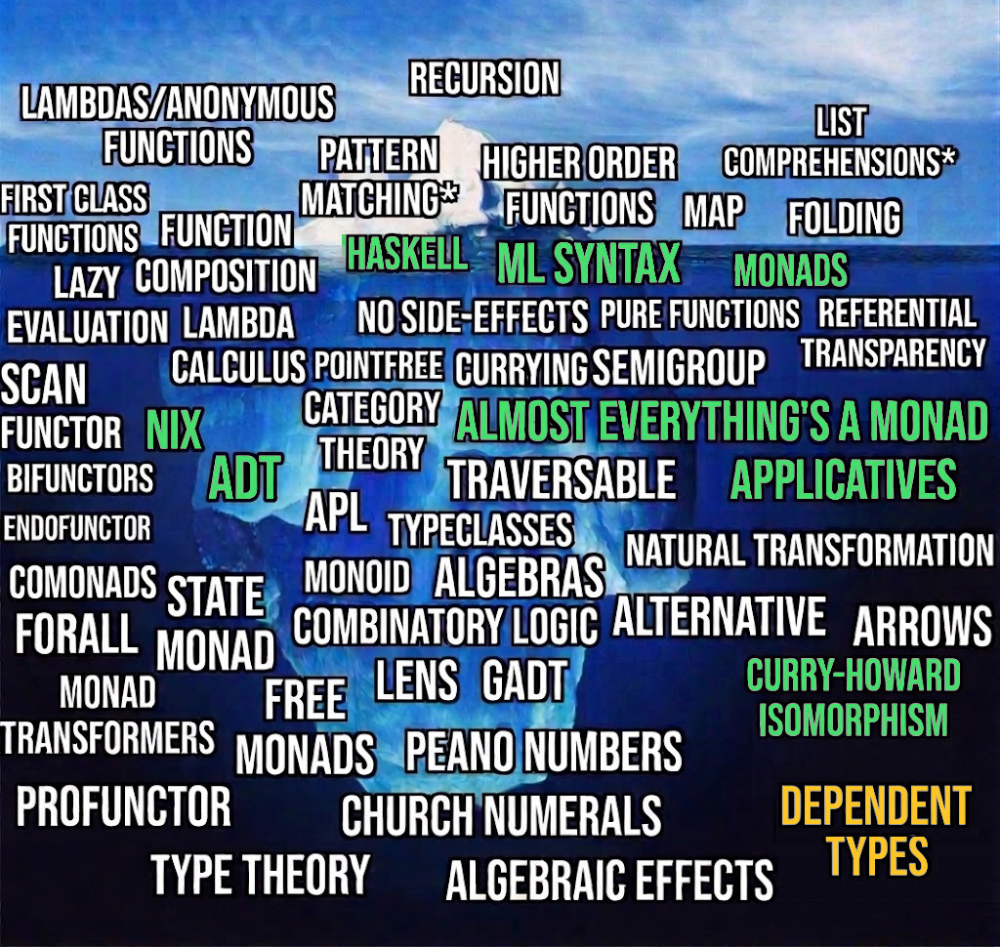
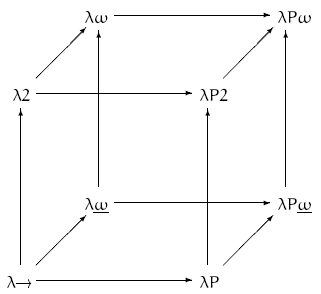
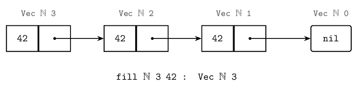
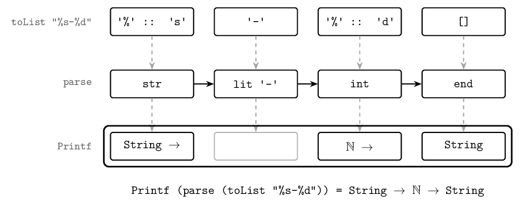
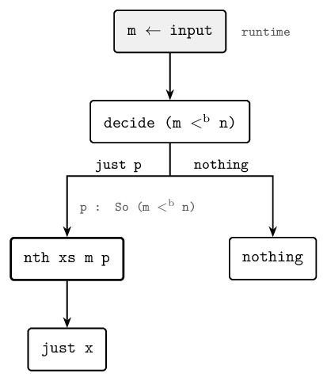
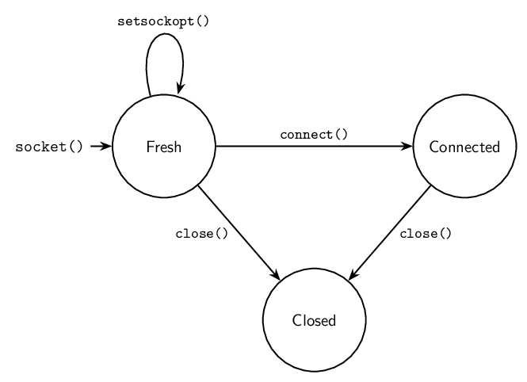

# Залежні типи у програмуванні

Давно хотів потішити суспільство статтею про залежні типи.
І ось пан мав час та натхнення.
Як я дійшов до цього?
Якось на очі мені потрапив функціональний айсберг:



Там було так багато красивих та незрозумілих слів,
що я швидко дійшов до висновку, що доки я не розберуся що це означає,
то не буду справжнім розробником, а життя буде прожите марно.
І ось, як трошички розібрався, то закортіло поділитися.
Про щось я вже написав статті, ці топіки позначені зеленим.
І зараз наша тема це залежні типи.

Ця тема позначена жовтеньким, та знаходиться на самому дні айсберга.
Чи означає це, що вона складна?
Напевно так.
Причому, складна навіть не сама ідея, її напевно можна сформулювати в одному реченні.
Складність виникає більше від калейдоскопу можливостей, та від того, що інтуїції нема на що обіпертися.
Це як шаблони в C++.
Нібито ідея проста та зрозуміла: підставляти різні значення під час компіляції.
Але... метапрограмування на шаблонах...
Заздрю тим хто не стикався.

Тому для більшості цей матеріал буде складним.
Але якщо вам цікаво та інтригуюче, але складно, то дам пораду.
Як на мене, абсолютно не завадить просто пропускати складні місця.
Це ще Роджер Пенроуз в книзі «Шлях до реальності, або Закони, що керують Всесвітом» писав.
Не розумієш звідки формула виникла?
Пропусти.
Не до кінця зрозумілі деталі?
Пропусти.
Він навіть наводив приклад, що шахи в його сім'ї займали почесне місце,
а Джонатан Пенроуз, молодший брат Роджера, навіть
[обігрував](https://www.chessgames.com/perl/chessgame?gid=1105990)
в далекому 1960-му тодішнього чемпіона світу Міхайла Таля...
Так от, Роджер не захоплювався шахами, але інколи гортав книги або журнали,
ігнорував ходи, та, на його погляд, щось та розумів.

Я і сам, коли гостував на літніх канікулах у дядька,
читав в 11 років Дональда Кнута, про його машину MIX, про алгоритми...
Мало що розумів, але було дико цікаво, може тому й обрав стезю розробника.
Тому якщо чіпляє, то читайте, щось та лишиться.
А якщо ніт, то на світі є багато інших цікавих справ.
Можете вивчити TypeScript.


## Ідея

Якщо запитати що таке залежні типи, то можливо дехто пригадає лямбда-куб.
Це класифікація лямбда-обчислень за трьома фічами: поліморфні типи, оператори над типами та залежні типи.
Кожна ознака це окрема вісь.
На wikipedia це проілюстровано так:



Тобто є базове типізоване лямбда-обчислення, яке ми можемо розширювати:
дозволити термам залежати від типів (поліморфізм, λ2),
типам від типів (оператори над типами, λω),
а типам від термів (залежні типи, λP).
Всі вони незалежні, тому, можливі в теорії, але, напевно, можна знайти такі точки на цьому кубі,
без жодної бодай трохи популярної мови програмування.

З трьох осей залежні типи найскладніші, і окремо вони майже не трапляються,
їх зазвичай беруть разом з двома іншими.
Всі приклади в цій статті будуть на таких λPω мовах програмування: Agda 2, Idris 2 та Lean 4.

Але наскільки вони корисні?
Можливо хтось знає, що переважну частину сучасної математики можна записати за допомогою залежних типів.
Тут їх користь вже не викликає жодного сумніву.
Доведення, перевірене в Lean, це сьогодні найвищий рівень математичної достовірності.

Але наскільки вони корисні у програмуванні?
Мені хочеться кричати: «Дуже! Дуже!»
Можна також помітити, що навіть Haskell поступово розвивається у бік підтримки залежних типів.
Але я обмежусь більш обережним: «Це досить цікава концепція».
Окрім загального пояснення в статті для ілюстрації цієї цікавості будуть три різних практичних приклади саме з програмування,
без доведення теорем.

Отже, що таке залежні типи?
Навіть у книгах, присвячених мовам із залежними типами,
як-от Type-Driven Development with Idris (Edwin Brady)
чи Verified Functional Programming in Agda (Aaron Stump),
окремого визначення ви не знайдете.
Розуміння приходить само собою: читаєш про мову, робиш вправи, звикаєш,
і десь по дорозі доходить, що це таке.
Ну... я спробую якось пояснити цю ідею без глибокого занурення для тих, кому цікаво.

Залежні типи це така концепція, що для будь-якого списку аргументів,
чи то виклик функції чи параметри нового типу,
тип кожного наступного аргументу або тип результату може залежати від значень попередніх.

Звучить плутано, тому я спробую підібрати якусь аналогію.
Найбільше залежні типи мені нагадують шаблони C++.
Давайте подивимося на наступний код:

```cpp
template<class T, int N>
std::array<T, N> fill(const T& value) {
    std::array<T, N> result;
    for (int i=0; i<N; ++i)
        result[i] = value;
    return result;
}

auto a = fill<int, 3>(42);
auto b = fill<int, 5>(67);
```

Подивимося на шаблонну функцію `fill`.
По суті вона приймає три аргументи: `T`, тобто тип елементів масиву,
`N`, тобто кількість елементів, і значення типу `T`.
Функція повертає масив, тип якого залежить від `N`, а `N` це значення, а не тип.
Саме в цьому й полягає ідея залежних типів: тип може залежати від значення.
Є тільки трохи але.

По-перше, нам не треба окремо розділяти
параметри шаблону (або дженеріка) та аргументи функції.
У мовах зі залежними типами ми просто пишемо `fill Int 3 42`.
Більшість з них використовує ML-нотацію,
це аналог звичайного `fill(Int, 3, 42)`.
Те, що тип кожного наступного параметра може залежати від попередніх,
це звичайне правило списку аргументів.

По-друге, в C++ параметри шаблону це константи часу компіляції,
а от в залежних типах значення часто відоме під час компіляції,
але це не обов'язкова вимога.

Які найближчі аналоги для цього прикладу можна знайти в інших мовах?

Zig:

```zig
fn fill(comptime T: type, comptime N: usize, value: T) [N]T {
    var result: [N]T = undefined;
    for (0..N) |i|
        result[i] = value;
    return result;
}

const a = fill(i32, 3, 42);
const b = fill(i32, 5, 67);
```

Тут слово `comptime` позначає параметри,
значення яких має бути відоме під час компіляції.
І тип `T` передається так само, як число `N`, без жодних кутових дужок.
Це найближчий синтаксис до того, що є в мовах програмування
зі залежними типами.

Rust:

```rs
fn fill<T: Copy, const N: usize>(value: T) -> [T; N] {
    [value; N]
}

let a = fill::<i32, 3>(42);
let b = fill::<i32, 5>(67);
```

Тут `Copy` позначає, що значення типу `T` можна копіювати.

Але у всіх цих мовах лишається обмеження:
значення, яке потрапляє в тип, мусить бути відоме під час компіляції.

Переходимо до мов програмування зі залежними типами.
Відповідний код буде виглядати так:

Agda:

```agda
fill : (A : Set) → (n : ℕ) → A → Vec A n
fill A zero    _ = []
fill A (suc n) x = x ∷ fill A n x

a : Vec ℕ 3
a = fill ℕ 3 42

b : Vec ℕ 5
b = fill ℕ 5 67
```

Idris:

```idris
fill : (a : Type) -> (n : Nat) -> a -> Vect n a
fill a Z     _ = []
fill a (S k) x = x :: fill a k x

a : Vect 3 Nat
a = fill Nat 3 42

b : Vect 5 Nat
b = fill Nat 5 67
```

Lean 4:

```lean
inductive Vec (α : Type) : Nat → Type where
  | nil  : Vec α 0
  | cons : α → Vec α n → Vec α (n + 1)

def fill : (α : Type) → (n : Nat) → α → Vec α n
  | _, 0,     _ => .nil
  | α, n + 1, x => .cons x (fill α n x)

def a : Vec Nat 3 := fill Nat 3 42
def b : Vec Nat 5 := fill Nat 5 67
```

Код повністю аналогічний, різниця майже тільки в назвах.
Рядки відповідають один одному.

Перший рядок це сигнатура функції.
Тип, який містить типи, в Agda називається `Set`, а в Idris та Lean це `Type`.
Тип, який містить натуральні числа (а нуль це натуральне число) в Agda це ℕ,
в Idris та Lean це `Nat`.
Тип вектор, який насправді список, в Agda це `Vec`, в Idris це `Vect`,
а в Lean довелося написати власний велосипед.
Вбудований `Vector` у core зроблений поверх масиву, а `List.Vector` з Mathlib тягти сюди не хотілося.
Але можна бачити, як тип визначений під капотом:
майже як класичний список, тільки ми додатково рахуємо кількість елементів.
Порожній вектор має нульову довжину, а додавання елемента збільшує довжину на одиницю.



Це тип-конструктор, який приймає тип елементів та їх кількість,
аналогія з масивом за інтерфейсом, але не за розташуванням в пам'яті.
І тут Idris приймає спочатку кількість, а тип це другий параметр, на відміну від інших.

Далі йде паттерн-матчинг та рекурсивний виклик.
Другий рядок це випадок, коли ми створюємо вектор з нуля елементів.
Знову нуль матчиться по-різному: `zero` в Agda, `Z` в Idris та звичайний 0 в Lean.
Порожній вектор це `[]` в Agda та Idris та конструктор `Vec.nil` в Lean.

Третій рядок це рекурсивний виклик.
Для Agda та Idris ми використовуємо конструктор списку у вигляді операції:
`∷` в Agda та `::` в Idris, зліва голова, справа хвіст.
Для Lean викликаємо конструктор `Vec.cons` у функціональному вигляді, не через операцію.
Те, що значення параметра `n` більше нуля, записується через конструктор наступного числа
(`suc` в Agda та `S` в Idris) та через звичайне `n+1` в Lean.
Читати треба приблизно так: якщо натуральне число можна записати як `n+1`, то виконати рекурсивний виклик.
`0` не можна записати як `n+1`, бо тоді `n` має бути від'ємним числом (мінус одиниця), а воно не натуральне.
Усі інші натуральні числа можна записати як `n+1`, як то `1=0+1`, `2=1+1`, `3=2+1`, ..., `96=95+1`.
Зазвичай рекурсивні виклики використовують `n-1`, наприклад

```cpp
int factorial(int n) {
    return n == 0 ? 1 : n * factorial(n-1);
}
```

а тут ми параметр записуємо як `n+1`, тому викликаємо просто `n`.
У цій гілці компілятор знає, що результат має тип вектора довжини `n+1`,
а конструктор приймає хвіст довжини `n`, і рекурсивний виклик дає саме його.
Тобто паттерн-матчинг по звичайному значенню `n` одночасно уточнює тип результату функції.
Саме так працюють залежні типи.

Різниця у синтаксисі паттерн-матчингу, я думаю, зрозуміла без пояснень.


## Неявні аргументи

Ті, хто програмував на C++, знають, що шаблонні параметри необов'язково задавати явно.
Дійсно, коли ми викликаємо `fill<MyObject, 7>(MyObject())`, тип MyObject дублюється.
Якщо поміняти параметри місцями, то можна записати `fill<7>(MyObject())`,
та компілятор сам здогадається, що `T` це `MyObject`.

У мовах зі залежними типами те саме робиться фігурними дужками `{}` в сигнатурі.
Тоді параметр стає неявним, задавати його не треба, компілятор виведе його самостійно.

Agda:

```
fill : {A : Set} → (n : ℕ) → A → Vec A n
fill zero    _ = []
fill (suc n) x = x ∷ fill n x

a : Vec ℕ 3
a = fill 3 42

b : Vec ℕ 5
b = fill 5 67
```

Idris:

```
fill : {a : Type} -> (n : Nat) -> a -> Vect n a
fill Z     _ = []
fill (S k) x = x :: fill k x

a : Vect 3 Nat
a = fill 3 42

b : Vect 5 Nat
b = fill 5 67
```

Lean:

```
inductive Vec (α : Type) : Nat → Type where
  | nil  : Vec α 0
  | cons : α → Vec α n → Vec α (n + 1)

def fill : {α : Type} → (n : Nat) → α → Vec α n
  | _, 0,     _ => .nil
  | _, n + 1, x => .cons x (fill n x)

def a : Vec Nat 3 := fill 3 42
def b : Vec Nat 5 := fill 5 67
```

В Agda та Idris неявний аргумент зникає з паттерн-матчингу, а в Lean на його місці все одно треба писати `_`.


## Коли тип є результат обчислення

Для багатьох (але не для мене) головний критерій функціональності мови програмування полягає у тому,
чи можна легко створювати нові функції на ходу, байдуже лямбда це чи замикання (closure),
тобто наскільки функції є громадянами першого класу.
В мовах програмування зі залежними типами природно виходить, що навіть самі типи стають громадянами
першого класу, та ми часто передаємо їх як значення в функції.
Коли це буває корисним?

Інколи в програмуванні виникає ситуація, коли тип значення залежить від даних.
Наприклад, парсинг JSON, коли схема відома наперед.
Навіть коли ми впевнені, що схема перевірена і поле `age` точно ціле,
прочитати його без зайвого перетворення типів складно, без спеціалізованого методу на кшталт `readInt("age")`.

Є два мейнстрімних способи це обійти.
Рефлексія, коли поля класів отримують атрибути, а структуру можна прочитати в рантаймі так само як звичайні дані.
Інший спосіб це генерація коду, як в protobuf чи Rust `serde`, який поверне те, що треба.

Ми розглянемо трохи інший приклад, а саме відому сішну функцію `printf`.
Проблема виникає досить аналогічна, типи аргументів обчислюються від рядка форматування.
Наша задача уникнути ситуацій, коли передається один тип, а у форматі стоїть інший.

Часто це вирішується тим, що у компілятор додають сакральні знання щодо специфікатора формату.
Але це буде обмежувати нас використанням саме цього формату, для підтримки нового треба патчити компілятор.
Інший варіант полягає у тому, щоб компілятор сам розпарсив формат та перевірив.
Для цього треба просунуті можливості на кшталт `consteval` в C++ та макросів Rust.
Або специфікатор `comptime` в Zig, який я вирішив проілюструвати.
Отже, як це буде виглядати?

Для початку зробимо допоміжні імпорти та функції.
Алокатор це вимога Zig, за замовчуванням нічого немає, тому параметр цього типу зазвичай свідок того,
що функція буде робити алокації.
Плюс перетворення числа в рядок:

```zig
const std = @import("std");
const Allocator = std.mem.Allocator;
const ArrayList = std.ArrayList;

fn intToStr(buf: []u8, v: i32) []const u8 {
    return std.fmt.bufPrint(buf, "{d}", .{v}) catch unreachable;
}
```

Далі вже починається трохи магії:

```zig
fn Args(comptime fmt: []const u8) type {
    var types: []const type = &.{};
    for (fmt, 0..) |c, i| {
        if (c != '%') continue;
        if (fmt[i + 1] == 'd') types = types ++ [_]type{i32};
        if (fmt[i + 1] == 's') types = types ++ [_]type{[]const u8};
    }
    return @Tuple(types);
}
```

Це функція, яка приймає рядок формату та повертає кортеж очікуваних типів.
Ми бачимо що аргумент `fmt` позначений як `comptime`, це вказівка компілятору,
що це значення має бути відомим під час компіляції.
Динамічно створити формат та передати його в цю функцію не вийде!

Сама реалізація циклу тривіальна: йдемо по формату, як тільки знайшли про́цент,
відразу у масив типів додаємо відповідний тип.

`[_]type{i32}` це езотеричний шлях Zig описувати масиви.
Так `[4]i32{1, 2, 3, 4}` це масив цілих довжини 4, а `_` означає порахуй довжину сам.


Далі сама функція `cfmt`:

```zig
fn cfmt(alloc: Allocator, comptime fmt: []const u8, args: Args(fmt)) ![]u8 {
    var out: ArrayList(u8) = .empty;

    comptime var k = 0;
    comptime var i = 0;
    inline while (i < fmt.len) : (i += 1) {
        if (fmt[i] != '%') {
            try out.append(alloc, fmt[i]);
            continue;
        }

        i += 1;

        if (fmt[i] == 'd') {
            var buf: [16]u8 = undefined; // "-2147483648"
            const s = intToStr(&buf, args[k]);
            try out.appendSlice(alloc, s);
        }

        if (fmt[i] == 's') {
            try out.appendSlice(alloc, args[k]);
        }

        k += 1;
    }

    return out.toOwnedSlice(alloc);
}
```

Тут особливо проблем немає, `args[k]` це k-й аргумент, тип якого вже прорахований (`Args`) та відомий компілятору при конкретному виклику.
`inline` змусить компілятор розгорнути цикл, спростити всі `if`, тому в кожній умові ми будемо бачити тип аргументу.
Гілки з хибною умовою компілятор просто викидає, не перевіряючи типи, тому `appendSlice` ніколи не побачить `i32`.

Наприклад, припустимо, що був виклик для рядка формату `"a%sb%dc"`.
Виконавши всі дії, компілятор отримає

```zig
Args(fmt) = [_]type{[]const u8, i32}
try out.append(alloc, 'a');
try out.appendSlice(alloc, args[0]); // тип []const u8
try out.append(alloc, 'b');
var buf: [16]u8 = undefined;
const s = intToStr(&buf, args[1]); // тип i32
try out.appendSlice(alloc, s);
try out.append(alloc, 'c');
```

Лишилося лише перевірити що все працює:

```zig
pub fn main() !void {
    const alloc = std.heap.page_allocator;

    const e = try cfmt(alloc, "Spin of %s equals %d/2", .{ "electron", 1 });
    defer alloc.free(e);
    std.debug.print("{s}\n", .{e});

    const d = try cfmt(alloc, "Spin of %s equals %d/2", .{ "delta baryon", 3 });
    defer alloc.free(d);
    std.debug.print("{s}\n", .{d});

    // _ = try cfmt(alloc, "Spin of %s equals %d/2", .{ 1, "proton" });   // compiler error
    // _ = try cfmt(alloc, "Spin of %s equals %d/2", .{"photon"});        // compiler error
}
```

Дійсно, якщо запустити, то отримаємо


```
$ zig run fmt.zig
Spin of electron equals 1/2
Spin of delta baryon equals 3/2
```

Якщо розкоментувати рядок з протоном, то отримаємо таку помилку:

```
$ zig run fmt.zig
fmt.zig:59:54: error: expected type '[]const u8', found 'comptime_int'
    _ = try cfmt(alloc, "Spin of %s equals %d/2", .{ 1, "proton" });   // compiler error
                                                     ^
referenced by:
    callMain [inlined]: /nix/store/83qs3ksyjclr149vpxbaz1z18wvi9rms-zig-0.16.0/lib/zig/std/start.zig:698:59
    callMainWithArgs [inlined]: /nix/store/83qs3ksyjclr149vpxbaz1z18wvi9rms-zig-0.16.0/lib/zig/std/start.zig:638:20
    posixCallMainAndExit: /nix/store/83qs3ksyjclr149vpxbaz1z18wvi9rms-zig-0.16.0/lib/zig/std/start.zig:590:38
    2 reference(s) hidden; use '-freference-trace=5' to see all references
```

а якщо з фотоном, то таку:

```
$ zig run fmt.zig
fmt.zig:60:52: error: missing tuple field with index 1
    _ = try cfmt(alloc, "Spin of %s equals %d/2", .{"photon"});        // compiler error
                                                  ~^~~~~~~~~~
referenced by:
    callMain [inlined]: /nix/store/83qs3ksyjclr149vpxbaz1z18wvi9rms-zig-0.16.0/lib/zig/std/start.zig:698:59
    callMainWithArgs [inlined]: /nix/store/83qs3ksyjclr149vpxbaz1z18wvi9rms-zig-0.16.0/lib/zig/std/start.zig:638:20
    posixCallMainAndExit: /nix/store/83qs3ksyjclr149vpxbaz1z18wvi9rms-zig-0.16.0/lib/zig/std/start.zig:590:38
    2 reference(s) hidden; use '-freference-trace=5' to see all references
```

Час подивитися, що нам запропонують залежні типи.

### Agda

Подивимося, як таку задачу будуть вирішувати мови програмування зі залежними типами.
Почнемо з Agda.
Але спочатку головна ідея.
Отже, у нас є формат.
Було б непогано повернути для нього функцію, яка прийме всі необхідні аргументи,
та поверне відформатований рядок.

Тобто для формату `"%s%d"` має повернути тип функції,
що приймає рядок (`String`), число, нехай буде натуральне (`ℕ`),
та поверне рядок `String`.
Якщо брати синтаксис ML, то така функція запишеться як
`String → ℕ → String`.

Оскільки в мовах програмування зі залежними типами,
тип це таке саме значення як й цілі, то з цим у нас не виникне проблема:

```agda
{-# OPTIONS --guardedness #-}

open import Agda.Builtin.String using () renaming (primShowNat to showℕ)
open import Data.Char.Base      using (Char)
open import Data.List           using (List; []; _∷_)
open import Data.Nat            using (ℕ)
open import Data.String         using (String; toList; fromChar; _++_)
open import Function            using (_$_)
open import IO                  using (Main; run; putStrLn; _>>_)

data Format : Set where
  int : Format → Format
  str : Format → Format
  lit : Char → Format → Format
  end : Format

parse : List Char → Format
parse ('%' ∷ 'd' ∷ cs) = int (parse cs)
parse ('%' ∷ 's' ∷ cs) = str (parse cs)
parse (c ∷ cs)         = lit c (parse cs)
parse []               = end

Printf : Format → Set
Printf (int f)   = ℕ → Printf f
Printf (str f)   = String → Printf f
Printf (lit _ f) = Printf f
Printf end       = String
```

Файл починається з імпортів, серед яких IO, який дозволяє нам писати головну функцію, та друкувати рядки.
З ним тісно пов'язаний перший рядок, опція, з якою буде компілюватися код.
Оскільки Agda це мова, яка аналогічно з Lean використовується для побудови та перевірки математичних доведень,
де кожна функція має завершуватися, а ввід/вивід дозволяє писати нескінченні функції, наприклад,
нескінченно чекати ввід користувача, тому Agda вимагає прапорець `--guardedness`,
який дозволяє лише такі функції під окремим наглядом компілятора,
плюс там можуть виникати несумісності з іншими прапорцями.

Серед імпортів ми також бачимо досить дивні `[]`, `_∷_`, `_++_`, `_$_`, `_>>_`.
Це ті самі функції, які записані у вигляді операторів.
Символ `_` (позиція аргумента) це місце, де можна вставити вираз.
Наприклад, `++` це конкатенація рядків, `_++_` означає, що перший аргумент буде записаний зліва, а другий — справа від `++`.

Отже, після секції імпортів, у нас визначення типу розпарсеного рядка формату,
що по суті тег типу, додатково символ у разі літерала, випадок `lit`,
та решта формату.

У функції `parse` можна бачити як елегантно робиться парсинг у функціональних мовах програмування.
Так, мені тут кортить розповісти про монадічні парсеру, але точно не в темі цієї статті.
А от функція `Printf` й повертає `Set` читай те що ми називали `type` у Zig.
В даному разі в залежності від аргументу вона повертає або `String` (кінець формату),
або решту формата (літерал) або функції `ℕ` або `String` в решту формата (`int` або `str`).

Наприклад, якщо у нас `"%s-%d"` тобто `[str, lit '-', int, end]`, то функцію можна відтрасувати так:

```
Printf [str, lit '-', int, end] =
String → Printf [lit '-', int, end] =
String → Printf [int, end] =
String → ℕ →  Printf [end] =
String → ℕ → String
```



тобто для цього формату результатом буде функція, яка приймає `String` та `ℕ` а повертає `String`.
Якщо хтось знає про каррінг, то це воно.

Йдемо далі:

```agda
render : (f : Format) → String → Printf f
render (int f)   acc = λ n → render f (acc ++ showℕ n)
render (str f)   acc = λ s → render f (acc ++ s)
render (lit c f) acc = render f (acc ++ fromChar c)
render end       acc = acc
```

Тут цікаво.
Знову перевіримо як це буде працювати на прикладі нашого формату `"%s-%d"`.
Спочатку сигнатура функції.
`Printf (parse $ toList "%s-%d")` це `String → ℕ → String`, тому сигнатура розкриється у

```
render : Format → String → String → ℕ → String
```

тобто функція, яка буде приймати розпарсений формат, що вже відформатовано
(перший виклик пустий рядок), далі аргументи, далі рядок повністю.
Тому цілком можна викликати як

```
render (parse $ toList "%s-%d") "prefix: " "test" 42
```

вона має повернути `"prefix: test-42"`.
Точніше поки що бачимо, що перевірка типів пройде.

Ну а тіло функції просто йде по формату.
Зустріли `%s` чи `%d`, повертаємо функцію, яка дописує відповідний аргумент в `acc`.
Тут використовується синтаксис анонімної функції: `λ n → render f (acc ++ showℕ n)` це те саме,
що в Python `lambda n: render(f, acc + str(n))`.
Зустріли звичайний символ, дописуємо його одразу.
Дійшли до `end`, повертаємо все, що накопичили.

Далі чиста техніка: зібрати все разом та викликати:

```agda
cfmt : (fmt : String) → Printf (parse (toList fmt))
cfmt fmt = render (parse (toList fmt)) ""

main : Main
main = run do
  putStrLn $ cfmt "Spin of %s equals %d/2" "electron" 1
  putStrLn $ cfmt "Spin of %s equals %d/2" "Ω baryon" 3
  -- putStrLn $ cfmt "Spin of %s equals %d/2" 1 "proton" -- compiler error
  -- putStrLn $ cfmt "Spin of %s equals %d/2" "photon"   -- compiler error
```

Успішний запуск:

```
$ ./Fmt
Spin of electron equals 1/2
Spin of Ω baryon equals 3/2
```

Звісно що уважимо повідомлення про помилки.
Перший закоментований рядок дасть нам

```
$ agda --compile Fmt.agda
Checking Fmt (/home/agda/labs/Fmt.agda).
/home/agda/labs/Fmt.agda:45.44-45: error: [UnequalTerms]
ℕ != String
when checking that the expression 1 has type String
```

і це дуже зрозуміло, ми переплутали порядок, замість рядка передали число,
про це й повідомлення.

Другий рядок:

```
$ agda --compile Fmt.agda
Checking Fmt (/home/agda/labs/Fmt.agda).
/home/agda/labs/Fmt.agda:46.14-52: error: [UnequalTerms]
(ℕ → Printf (parse ('/' ∷ '2' ∷ []))) !=< String
when checking that the expression
cfmt "Spin of %s equals %d/2" "photon" has type String
```

тут складніше, ми забули аргумент, тому виходить так, що наша функція очікує `String`,
але ми повертаємо `ℕ → String`, на що й скаржиться компілятор.
От тільки він не довів обчислення до кінця, рядок `"/2"`, кінець формату, який ми бачимо,
не містить символів форматування, тому це просто `String`.

### Idris

Код на Idris буде повністю аналогічним тому що ми бачили на Agda.
Різниця лише в синтаксисі:

```idris
data Format = Number Format | Str Format | Lit Char Format | End

parse : List Char -> Format
parse ('%' :: 'd' :: cs) = Number (parse cs)
parse ('%' :: 's' :: cs) = Str (parse cs)
parse (c :: cs)          = Lit c (parse cs)
parse []                 = End

Printf : Format -> Type
Printf (Number f) = Nat -> Printf f
Printf (Str f)    = String -> Printf f
Printf (Lit _ f)  = Printf f
Printf End        = String

render : (f : Format) -> String -> Printf f
render (Number f) acc = \n => render f (acc ++ show n)
render (Str f)    acc = \s => render f (acc ++ s)
render (Lit c f)  acc = render f (acc ++ pack [c])
render End        acc = acc
```

По-перше, ми бачимо, що зникли імпорти.
Agda пішла шляхом «ніяких нав'язаних основ»:
стандартна бібліотека це окремий пакет, який можна не підключати,
і деякі бібліотеки так і роблять, визначаючи навіть натуральні числа по-своєму.
Тому навіть саме базове використання має бути запротокольовано.

У цьому плані Idris як мова програмування в першу чергу для програмістів, пішов шляхом більшої зручності.
Ми бачимо що все що треба вже є в базовій бібліотеці (`Prelude`),
тому можна сконцентруватися на написанні коду.

По-друге, тип описується більш компактно:
замість повного типу кожного конструктора
можна просто перелічити їх через `|`.

Також ми не бачимо Unicode, замість стрілочок ми бачимо комбінації ASCII символів `->`,
замість грецької лямбди бачимо зворотній слеш `\`.
В Agda тем можна писати так, але використання Unicode загальновживане та мені подобається більше.

Технічна частина також аналогічна:

```idris
cfmt : (fmt : String) -> Printf (parse (unpack fmt))
cfmt fmt = render (parse (unpack fmt)) ""

main : IO ()
main = do
  putStrLn $ cfmt "Spin of %s equals %d/2" "electron" 1
  putStrLn $ cfmt "Spin of %s equals %d/2" "Ω baryon" 3
  -- putStrLn $ cfmt "Spin of %s equals %d/2" 1 "proton" -- compiler error
  -- putStrLn $ cfmt "Spin of %s equals %d/2" "photon"   -- compiler error
```

Запускаємо, все працює:

```
$ idris2 -o Fmt Fmt.idr
$ build/exec/Fmt
Spin of electron equals 1/2
Spin of Ω baryon equals 3/2
```

Лишилися лише повідомлення про помилки.
Перша:

```
$ idris2 -o Fmt Fmt.idr
Error: While processing right hand side of main. Can't find an implementation for Num String.

Fmt:28:44--28:45
 24 | main : IO ()
 25 | main = do
 26 |   putStrLn $ cfmt "Spin of %s equals %d/2" "electron" 1
 27 |   putStrLn $ cfmt "Spin of %s equals %d/2" "Ω baryon" 3
 28 |   putStrLn $ cfmt "Spin of %s equals %d/2" 1 "proton" -- compiler error
                                                 ^

Warning: compiling hole Main.main
```

Тут ми переплутали місцями аргументи, число замість рядку та навпаки.
От компілятор й скаржиться, що не знайшов реалізацію `Num` для `String`.
`Num` це інтерфейс для числових типів.
Справа в тому, що в Idris числовий літерал не має фіксованого типу,
`1` це насправді `fromInteger 1`, і він може стати `Nat`, `Int`, `Double`
чи будь-яким іншим типом, для якого є реалізація `Num`.
Але `String` з нього не зробиш.

Друга:

```
$ idris2 -o Fmt Fmt.idr
Error: While processing right hand side of main. When unifying:
    Nat -> Printf (parse [assert_total (prim__strIndex (fromString "Spin of %s equals %d/2") (prim__cast_IntegerInt (natToInteger (assert_total (integerToNat 20))))),
                          assert_total (prim__strIndex (fromString "Spin of %s equals %d/2") (prim__cast_IntegerInt (natToInteger (assert_total (integerToNat 21)))))])
and:
    String
Mismatch between: Nat -> Printf (parse [assert_total (prim__strIndex (fromString "Spin of %s equals %d/2") (prim__cast_IntegerInt (natToInteger (assert_total (integerToNat 20))))),
                                        assert_total (prim__strIndex (fromString "Spin of %s equals %d/2") (prim__cast_IntegerInt (natToInteger (assert_total (integerToNat 21)))))]) and String.

Fmt:29:14--29:52
 25 | main = do
 26 |   putStrLn $ cfmt "Spin of %s equals %d/2" "electron" 1
 27 |   putStrLn $ cfmt "Spin of %s equals %d/2" "Ω baryon" 3
 28 |   -- putStrLn $ cfmt "Spin of %s equals %d/2" 1 "proton" -- compiler error
 29 |   putStrLn $ cfmt "Spin of %s equals %d/2" "photon"   -- compiler error
                   ^^^^^^^^^^^^^^^^^^^^^^^^^^^^^^^^^^^^^^

Warning: compiling hole Main.main
```

Тут повідомлення аналогічне тому, що ми бачили в Agda, тільки при обчисленні формату компілятор показує нутрощі `unpack`,
функції, якою ми конвертували рядок у список символів.


### Lean

Базовий код на Lean майже аналогічний:

```lean
inductive Format where
  | int : Format → Format
  | str : Format → Format
  | lit : Char → Format → Format
  | done : Format

def parse : List Char → Format
  | '%' :: 'd' :: cs => .int (parse cs)
  | '%' :: 's' :: cs => .str (parse cs)
  | c :: cs          => .lit c (parse cs)
  | []               => .done

def Printf : Format → Type
  | .int f   => Nat → Printf f
  | .str f   => String → Printf f
  | .lit _ f => Printf f
  | .done    => String

def render : (f : Format) → String → Printf f
  | .int f,   acc => fun n => render f (acc ++ toString n)
  | .str f,   acc => fun s => render f (acc ++ s)
  | .lit c f, acc => render f (acc.push c)
  | .done,    acc => acc
```

Так, `end` тепер це зарезервоване слово, тому замінено на `done`.
Опис типу як в Agda.
Код майже ідентичний в усіх мовах.

Але далі, в технічній частині з'явилися декілька моментів:

```lean
def cfmt (fmt : String) : Printf (parse fmt.toList) :=
  render (parse fmt.toList) ""

def putStrLn (s : String) : IO Unit := IO.println s

def main : IO Unit := do
  putStrLn $ cfmt "Spin of %s equals %d/2" "electron" 1
  putStrLn $ cfmt "Spin of %s equals %d/2" "Ω baryon" 3
  -- putStrLn $ cfmt "Spin of %s equals %d/2" 1 "proton" -- compiler error
  -- putStrLn $ cfmt "Spin of %s equals %d/2" "photon"   -- compiler error
```

Перший момент це функція `putStrLn`, яку довелося написати самостійно.
Стандартний `IO.println` приймає значення будь-якого типу, для якого є реалізація інтерфейсу `ToString`.
Але під час пошуку цієї реалізації компілятор не обчислює тип `Printf (parse ...)`,
тому не здогадується, що насправді це звичайний `String`, і падає з помилкою.

Це запускається та працює:

```
$ lake env lean --run Fmt.lean
Spin of electron equals 1/2
Spin of Ω baryon equals 3/2
```

З помилками цікавіше.
Якщо розкоментувати перший рядок, то отримаємо

```
$ lake lean Fmt.lean
Fmt.lean:33:43: error(lean.synthInstanceFailed): failed to synthesize instance of type class
  OfNat String 1
numerals are polymorphic in Lean, but the numeral `1` cannot be used in a context where the expected type is
  String
due to the absence of the instance above

Hint: Type class instance resolution failures can be inspected with the `set_option trace.Meta.synthInstance true` command.
```

В принципі зрозуміло, що прочитали число `1` там де очікувалося `String`.
А от друга...

```
$ lake lean Fmt.lean
Fmt.lean:34:13: error: Application type mismatch: The argument
  cfmt "Spin of %s equals %d/2" "photon"
has type
  Printf
    (parse
      (((((((((((([].concat
                                                    {
                                                      val :=
                                                        "Spin of %s equals %d/2".toByteArray[0 +
...................................
Пропущено біля 2400 рядків
...................................
                            ⋯).concat
                        ⋯).concat
                    ⋯).concat
                ⋯).concat
            ⋯).concat
        ⋯))
but is expected to have type
  String
in the application
  putStrLn (cfmt "Spin of %s equals %d/2" "photon")
```

Це і є другий цікавий момент.
Так, легко бачити що очікується тип `String`,
а от що передалося замість нього...
Просто величезне трасування бібліотечної функції перетворення масиву байт в UTF-8 кодуванні в список символів.

І ще.
А чи можна викликати `cfmt` з форматом, який прийшов у рантаймі?
Так, можна, але тоді нам треба якось переконати компілятор, що формат та типи аргументів відповідають одне одному.
Це робиться не дуже просто, тому деталі опустимо.
Скажу лише, що ідеї аналогічні тим, що будуть у наступному розділі.


## Контракти

Дуже часто перша дія, яку робить функція при виклику, це перевірка аргументів.
Якщо аргументи невалідні, то або повертає код помилки: C (`errno`, `EINVAL`), Go (`(value, error)`), Rust (`Result`/`Option`),
або кидає виняток: C++ (`std::invalid_argument`), Java (`IllegalArgumentException`), C# (`ArgumentException`), ...
В Python: немає одного винятку, натомість декілька можливих: `TypeError`, `ValueError`, `IndexError`.

Це здається настільки природним, що навіть важко уявити альтернативи.
Часто, коли перевірка аргументів може бути накладною, то поруч пишуть окрему функцію без перевірки.
Наприклад, в Linux Kernel для цього існує конвенція коду, коли префікс `__` на початку назви функції означає, що це низькорівнева версія, а виконання передумов лягає на самого викликача.
В інших мовах інше іменування: Rust — суфікс `_unchecked`, Swift — префікс `unsafe`, тощо.

Але є інший шлях.
Популярним він став завдяки мові програмування Eiffel.
Звідти й пішла назва цьому: контракти.
Ідея полягає в тому, щоб умови, які накладаються на аргументи, описувати явно.
Замість того, щоб перевірка ховалася десь в тілі функції, або трималася на негласній домовленості,
вона стає частиною самого контракту між викликачем і функцією.
Те, що гарантує викликач, отримало назву пре-умова (pre-condition).
А те, що гарантує функція, отримало назву пост-умова (post-condition).

Наприклад, коли ми викликаємо функцію, яка повертає n-й елемент масиву,
то пре-умова буде, що індекс n лежить в межах масиву.
А для функції сортування пост-умовою буде, що результат відсортований і містить ті самі елементи, що й вхідний масив.

Якщо умова описана формально, а не просто в коментарі чи документації, це дає компілятору більше волі.
Умову можна перевірити як звичайний `assert` під час виконання,
можна взагалі викинути перевірку, якщо з контексту й так видно, що вона завжди виконується.
А можна спробувати довести її математично за допомогою спеціальної програми, яка називається солвером.
Саме так це працює в Ada/SPARK, контракти там перевіряє SMT-солвер,
який доводить виконання умови для всіх можливих вхідних даних, а не просто перевіряє її під час одного конкретного запуску.

Але в широкі маси це поки що не дійшло.
Відносно свіжа новина: в C++26 прийняли пропозицію P2900, яка додає контракти прямо в стандарт.
Виглядає це так, думаю синтаксис зрозумілий з контексту.

```cpp
int nth(const std::vector<int>& v, size_t n)
    pre(n < v.size())
{
    return v[n];
}

void sort(std::vector<int>& v)
    post(std::is_sorted(v.begin(), v.end()))
{
    std::sort(v.begin(), v.end());
}
```

SMT-солвери в стандарт C++ ще не завезли, поки що за допомогою прапорців можна обирати чотири варіанти поведінки:
при (1) `ignore` перевірка взагалі не відбувається, читай виключений `assert`,
при (2) `observe` умова перевіряється, і якщо вона не виконалася, буде викликаний обробник, після чого виконання продовжиться,
при (3) `enforce` умова теж перевіряється, при порушенні викликається обробник, а потім програма завершується,
при (4) `quick_enforce` програма при порушенні завершується відразу, без обробника, читай аналог `abort`.

В інших широко розповсюджених мовах програмування станом на зараз це або експерименти, або зовнішні інструменти.

А яку відповідь нам дають мови програмування зі залежними типами?
Невеличкий трюк дозволяє природним чином додати контракти в сигнатуру функції.
Для початку розглянемо наш приклад з `nth`:

```agda
data So : Bool → Set where
  oh : So true

nth : {n : ℕ} (v : Vec String n) (m' : ℕ) → So (m' <ᵇ n) → String
nth (x ∷ _)  zero    _ = x
nth (_ ∷ xs) (suc m) p = nth xs m p
```

Давайте спробуємо розібрати цей код.
Починати його треба з функції `nth`, яка складається з трьох рядків.
Перший це сигнатура функції, які типи приймає, що повертає.
Другий та третій це її тіло.

Що цікавого в сигнатурі?
Давайте розберемося з параметрами.
На початку йде `n`, вочевидь це довжина вектора рядків.
Далі `v`, сам вектор рядків довжини `n`.
Потім йде `m'`, індекс елемента, який ми хочемо отримати.
Трохи дивно, що апостроф є частиною імені, але певна зручність є, читається як m штрих, привіт математиці.
Далі якась інопланетна маячня, в принципі око може знайти знайомий потрібний нам паттерн `m' < n`, обгорнутий в абракадабру.
Ми його розберемо в деталях пізніше.
Функція очікувано повертає String.

Реалізація функції типова для функціонального програмування,
по суті це аналог наступного коду Python:

```python
def nth(lst, m):
    x, *xs = lst
    if m == 0:
        return x
    else:
        return nth(xs, m-1)
```

`x` це перший елемент вектору,
`xs` це решта елементів, вектор, довжина якого буде на одиницю менше, ніж `v`.
По суті в паттерн-матчингу ми розбираємо дві альтернативи, або параметр `m'` дорівнює нулю (`zero`),
це рядок два.
Тоді просто повертаємо перший елемент.
Або параметр `m'` не дорівнює нулю, третій рядок, тоді його можна написати як `m+1`,
або наступний (successor) елемент після `m`, або `suc m`.
Звідки `m=m'-1`, що й передається рекурсивно.
Магію з параметром `p` знову поки що пропускаємо.

А що буде, коли ми передали порожній вектор?
Haskell у цьому випадку залежно від опцій або впаде runtime,
або на етапі компіляції попросить нас не забути про цей випадок.
Agda в цьому плані цікавіша, вона потребує розбирати всі можливі варіанти.
Але цей код компілюється.
У чому справа???

Там спрацьовує саме магія `So`.
Якщо вектор `v` порожній, то й його довжина `n` дорівнює нулю, інакше просто не буває.
А натурального числа `m'`, меншого за нуль, не існує.
Тому пустий вектор передати не вийде.
Тому цей випадок можна не описувати.
До речі, можна й описати.
Це буде виглядати як

```agda
nth [] _ ()
```

це так званий абсурдний паттерн.
Зверніть увагу, що на місці магічного параметру `p` тут стоїть `()`.
Це можна розуміти як підказку, що пустий вектор, абсурдний, неможливий, саме через аргумент `p`.
Але коли компілятор сам здатен докумекати, його зазвичай не пишуть.

Ну що, тепер нам зрозуміло усе, окрім магії `So`.
Ну... по правді кажучи, назва дуже метафорична, люди без почуття гумору назвали би цей тип `IsTrue` чи `StaticAssert`.
Бо його задача досить проста: перевірити на етапі компіляції, що певний вираз обчислюється у значення `true`.
Ми вже писали вище про аналогію між залежними типами та шаблонами у C++.
Колись, у стародавні часи, коли в стандарті C++ не було `static_assert`, його реалізовували через метапрограмування.
`static_assert` був типом, який параметризувався значенням типу `bool`, але для якого була визначена лише спеціалізація для `true`.
Тому, коли туди потрапляв `false`, то ви отримували простирадло про те, що не визначена потрібна спеціалізація шаблону.

Тут все майже один в один.
Тип `So` параметризується значенням `Bool`, але є лише один конструктор `oh`, тип якого зафіксований як `So true`.
Коли компілятор бачить `oh` останнім аргументом, він бачить, що тип `oh` — це `So true`,
та намагається узгодити його з тим, що бачить у сигнатурі, а саме `So (m' <ᵇ n)`.
Звідки починає перевіряти, що `m' <ᵇ n` має дорівнювати `true`, а це і є наша пре-умова!

От тільки чому такі дивні назви?
Давайте поглянемо на рядок `oh : So true`.
Так й хочеться прочитати це як “Oh! So true”
Українською це можна перекласти як «Ах! Дійсно це правда».
Саме через це й вибрані такі дивні імена.
Як бонус йде той факт, що ці метафоричні ідентифікатори короткі, та майже не засмічують код.
Цей трюк почав використовувати Конор Мак-Брайд (Conor McBride) у своїх лекціях з мови програмування Epigram,
а потім якось прижилося.

Отже, у підсумку, якщо компілятор зможе переконатися, що `m' <ᵇ n`, то код скомпілюється.
Якщо ні, то впаде з помилкою.
Це ілюструють наступні рядки:

```agda
example : Vec String 5
example = "a" ∷ "b" ∷ "c" ∷ "d" ∷ "e" ∷ []

third : String
third = nth example 2 oh

-- Compiler error
-- seventh : String
-- seventh = nth example 6 oh
```

Функція `third` скомпілюється прекрасно, бо `2 <ᵇ 5`.
А от, якщо розкоментувати `seventh`, то отримаємо помилку компіляції:

```
$ agda Contracts.agda
Checking Contracts (/home/agda/labs/Contracts.agda).
/home/agda/labs/Contracts.agda:26.25-27: error: [UnequalTerms]
true != false of type Bool
when checking that the expression oh has type So (6 <ᵇ 5)
```

Agda скаржиться, що правда це не брехня.
Дійсно, `oh` це `So true`, а `So (6 <ᵇ 5)` це `So false`.
Вони несумісні.
Наш статичний assert, пре-умова спрацювала!

Можливо вам цікаво, чому написано `<ᵇ`, а не просто `<`.
Математично «строго менше» це приклад відношення.
Ми приймаємо два об'єкти, у цьому прикладі два натуральних числа,
та кажемо «так» чи «ні», справедливо що перше число менше другого чи ні.

Так от, підходити до відношень можна з двох боків.
По-перше, ми можемо написати функцію, яка буде приймати два об'єкти, та повертати `true` або `false`
залежно від того, ми кажемо «так» чи «ні».
`<ᵇ` і є така функція, а ᵇ як верхній індекс це відсилка до типу Bool, результат булевий тип.

Але інколи це незручно.
Класика це мова програмування Prolog, визначення предка.
Кожен є предком самого себе, а ще предком дітей своїх нащадків.

```prolog
ancestor(X, X).
ancestor(X, Y) :- parent(Z, Y), ancestor(X, Z).
```

Інтуїтивно це можна зрозуміти так: кожен є нащадком самого себе.
А ще дитина нащадка сама є нащадком.

Так, можна написати функцію, яка буде приймати двох людей, та шукати по базі, чи є один нащадком іншого чи ні.
Але це складно.
Є інший підхід, хочеш довести що Ада є нащадком Паскаля?
То приведи ланцюжок осіб, який починається з Блеза Паскаля, закінчується на Аді Лавлейс,
а кожен наступний це син або донька попередньої особи.

Таким чином, відношення стає типом даних!
Який містить різноманітні доведення, що відношення виконується.
Наприклад, послідовність Енакін Скайвокер → Лея Органа → Кайло Рен
це доведення того, що Кайло Рен нащадок Енакіна Скайвокера.
Або, ланцюжок 2 → 3 → 4 → 5 це доведення того, що два менше п'яти, тобто він є значенням типу `2 < 5`.

А от якщо розглянути тип `6 < 5`, то він не містить значень взагалі.
Бо відповідний ланцюжок, це кожне наступне значення на одиницю більше попереднього, який починається від 6 та закінчується 5, побудувати неможливо.
Воїд тип, про який я розказував у статті про ADT.
Так от, оскільки Agda математична мова, то `<` без верхнього індексу ᵇ означає саме тип даних, а не функцію.

Це все добре, а от що робити, коли користувач вводить номер самостійно?
Як тоді нам викликати функцію `nth`?
Як задовольнити `So`???
Відповідь на це дає наступний код, де з'являється тип `Maybe`.
У нього два випадки, `just x` (значення є) або `nothing` (значення нема),
це аналог `Nullable<T>` в C#, `Option<T>` в Rust, `Optional<T>` в Java чи `Optional[T]` в Python.

```agda
decide : (b : Bool) → Maybe (So b)
decide true  = just oh
decide false = nothing

nth? : {n : ℕ} (xs : Vec String n) (m : ℕ) → Maybe String
nth? {n} xs m with decide (m <ᵇ n)
... | just p  = just $ nth xs m p
... | nothing = nothing
```

Так, трохи магії...
Спочатку `just $ nth xs m p`.
Усім відомо, що функціональні мови мають проблему з дужками.
Якось шахраї викрали останній мегабайт коду на LISP, але то були лише закриваючі дужки!
Так от `$` це спосіб вилікувати цю проблему.
Його можна читати, як дужки від цього моменту до кінця.
Тобто `just (nth xs m p)`.
Аналогічно, `putStrLn $ showMaybe $ nth? example 2`
це аналог `putStrLn (showMaybe (nth? example 2))`.

Далі, знак питання це частина ідентифікатора, це конвенція, спосіб повідомити, що функція поверне опціональне значення.

А тепер по суті.
По-перше, зникла з аргументів наша пре-умова `p`, яка містила доведення того, що індекс лежить в межах вектора.
По-друге, змінився тип результату зі `String` на `Maybe String`.
Але під капотом викликається `nth`!

Ідея полягає у тому, що замість того, щоб вимагати доведення `m <ᵇ n` від того, хто викликає функцію,
ми можемо обчислити цю умову самостійно.
Якщо це `true`, то ось вам доведення!
Якщо це `false`, то звиняйте, доведення немає.
`decide` саме перетворює значення `Bool` на можливе доведення.

А далі просто невеличкий паттерн-матчинг на результаті `decide`.
Якщо прийшло `just p`, викликаємо вже знайомий `nth` з доведенням `p`, яке нам підсунули.
Якщо `nothing`, то й доведення немає, а разом з ним і результату, повертаємо `nothing` напряму.

І ось тут вилазить головна різниця з `comptime` у Zig чи шаблонами C++.
Там значення, яке потрапляє в тип, мусить бути відоме під час компіляції, а тут індекс `m` може прийти звідки завгодно, з клавіатури, з файлу, з мережі.
Компілятор не знає, чому дорівнює індекс, тому змушує нас додати перевірку.



Лишилося лише продемонструвати, що все працює!
От код, який виводить результати, сподіваюся, що ви вже звикли до синтаксису Agda.

```agda
showMaybe : Maybe String → String
showMaybe (just s) = "just " ++ s
showMaybe nothing  = "nothing"

main : Main
main = run do
  putStrLn third
  -- putStrLn seventh
  putStrLn $ showMaybe $ nth? example 2
  putStrLn $ showMaybe $ nth? example 7
```

Переходимо на Idris.
Відмінності невеликі.

На початку можна бачити, що тип `So` переїхав у стандартну бібліотеку:

```idris
import Data.So
```

Далі, змінилася функція `nth`:

```idris
nth : (v : Vect n String) -> (m : Nat) -> So (m < n) -> String
nth []        Z     p = absurd p
nth []        (S _) p = absurd p
nth (x :: _)  Z     _ = x
nth (_ :: xs) (S k) p = nth xs k p
```

Тут дві зміни. Неявний параметр `n` зник з сигнатури.
Це така фіча Idris, якщо змінна в сигнатурі не оголошена, але її тип можна вивести,
то вона стає неявною змінною.
Саме тут `n` ніяк не оголошена, з `Vect n String` легко бачити, що `n` може бути лише типу `Nat`,
тому саме цей випадок.

Далі, з'явилися два зайвих рядки.
Через дрібні відмінності у визначенні операції `<` компілятор Idris не може сам зрозуміти, що випадок,
коли `nth` викликається з порожнім вектором, ніколи не може трапитися.
Тому довелося додати два зайвих рядки для цього.

Подивимося на праву частину.
Вона звучить максимально метафорично: вираз `p` стає абсурдним!
А що у нас `p`?
Це `So (m < n)`.
Що нам про нього відомо?
Ну... якщо вектор `v` пустий, то `n` має дорівнювати нулю.
Тобто маємо `So (m < 0)`.
Що звісно не виконається для жодного натурального `m`, бо числа менше за нуль просто не існує.

Так, нам довелося дещо спростити життя компілятору,
ми розібрали `m` на два конструктори, лише тоді він зміг підглянути у визначення операції `<`,
та зрозуміти, що він завжди `False`, а `So False` ніяк не можна створити...
Зупинимося...
Функція приймає аргумент, який неможливо створити.
Це означає, що якщо ми досягли цього рядку, то ми створили те, що неможливо створити.
Інакше кажучи це `assert(false)`, тільки доведений компілятором.
А раз так, то ми гарантовано сюди ніколи не потрапимо, і ця гілка ніколи не виконається.

Також `<` це аналог `<ᵇ` з Agda, а тип `LT` буде аналогом математичного визначення відношення.

Далі...

```idris
example : Vect 5 String
example = "a" :: "b" :: "c" :: "d" :: "e" :: []

third : String
third = nth example 2 Oh

-- Compiler error
-- seventh : String
-- seventh = nth example 6 Oh
```

Тут інший лише синтаксис, далі...

```idris
nth' : {n : Nat} -> (xs : Vect n String) -> (m : Nat) -> Maybe String
nth' {n} xs m = case choose (m < n) of
  Left  p => Just (nth xs m p)
  Right _ => Nothing
```

Тут все аналогічно, `decide` замінився на бібліотечний `choose`.
Також ми змушені явно оголошувати змінну `n`, бо в тілі функції ми самі рахуємо `m < n`, а неявні параметри, які компілятор вивів сам, під час виконання недоступні.
Далі...


```idris
main : IO ()
main = do
  putStrLn third
  -- putStrLn seventh
  putStrLn $ show $ nth' example 2
  putStrLn $ show $ nth' example 7
```

Тут обійшлися без `showMaybe`, бо компілятор сам знає, як його надрукувати.

І саме цікаве, це текст помилки компіляції, коли розкоментувати `seventh`:

```
$ idris2 -o Contracts Contracts.idr
Error: While processing right hand side of seventh. When unifying:
    True
and:
    False
Mismatch between: True and False.

Contracts:18:25--18:27
 14 | third = nth example 2 Oh
 15 |
 16 | -- Compiler error
 17 | seventh : String
 18 | seventh = nth example 6 Oh
                              ^^

Warning: compiling hole Main.seventh
```

Майже аналогічне повідомлення.

Перейдемо тепер до варіанту Lean.

```lean
inductive Vec (α : Type) : Nat → Type where
  | nil  : Vec α 0
  | cons : α → Vec α n → Vec α (n + 1)

def nth : (v : Vec String n) → (m : Nat) → Nat.blt m n → String
  | .cons x _,  0,     _ => x
  | .cons _ xs, k + 1, h => nth xs k h
```

Знову ми змушені визначати свій тип `Vec`.
`Nat.blt` означає саме функцію порівняння, це аналог `<ᵇ` з Agda, простий знак менше означає тип.
Також ми бачимо, що Lean сама зрозуміла абсурдні випадки без явного запису (для явного запису є `nomatch`).

Також ми бачимо, що обгортка `So` зникла, це тому, що Lean автоматично трактує вирази типу `Bool` в аргументах як аналог `So`.
Трохи синтаксичного цукру.


```lean
def sample : Vec String 5 :=
  .cons "a" (.cons "b" (.cons "c" (.cons "d" (.cons "e" .nil))))

def third : String := nth sample 2 rfl

-- Compiler error
-- def seventh : String := nth sample 6 rfl
```

Тут можливо запис списку не дуже зручний, можна перевизначати оператори, але не в цьому суть.
Замість нашого `oh` йде `rfl`, це скорочення від слова reflexivity,
яке використовується дуже часто в доведеннях.
Означає те саме: обчисли та переконайся, що вираз буде `true`.
Далі...

```lean
def nth? (v : Vec String n) (m : Nat) : Option String :=
  if h : Nat.blt m n
    then some (nth v m h)
    else none
```

Тут ми бачимо ще один синтаксичний цукор.
Замість `decide` або `choose` який повертає опціональне доведення, коли умова виконується,
в Lean можна просто в операторі `if` задати ім'я факту, який буде доступним нам в гілці `then`.
Цей факт можна потім передати як аргумент, що ми й робимо при виклику `nth`.

Ну й друк лишається майже аналогічним тому, що був в Idris:

```lean
def main : IO Unit := do
  IO.println third
  -- IO.println seventh
  IO.println $ toString $ nth? sample 2
  IO.println $ toString $ nth? sample 7
```

А яка буде помилка?
```
$ lean Contracts.lean
/home/lean/labs/Contracts.lean:15:37: error: Application type mismatch: The argument
  rfl
has type
  ?m.5 = ?m.5
but is expected to have type
  Nat.blt 6 5 = true
in the application
  nth sample 6 ⋯
```

Тут ми бачимо невеличкий нюанс, який пов'язаний з тим, як визначено `rfl`.
Це вже не булевий вираз, який має дорівнювати `true`, а рівність виразу самому собі.
А очікується рівність, де права частина `true` йде з нашого синтаксичного цукру, а ліва це і є наш вираз.
Далі бачимо `Nat.blt 6 5`, це наш `6 < 5`, та скаргу, що це ніяк не `true`,
так само, як ми інтерпретували `So` в Agda та Idris, тільки тут це робить сам компілятор, за кадром.

З контрактами поки що усе.


## Типостани

Кожен, хто займався програмуванням, стикався з життєвим циклом об'єктів.
Вони змінюють свій стан, і в кожному стані доступний свій набір операцій.
Візьмемо, наприклад, клієнтський мережевий сокет.
Після того, як він створений викликом `socket()`,
ми можемо налаштувати його викликами `setsockopt()`,
наприклад виставити розміри буферів `SO_RCVBUF` і `SO_SNDBUF`.
Потім ми викликаємо `connect()`, після якого ці налаштування вже тихо ігноруються.
Повторно викликати `connect()` також помилка.
І нарешті `close()`.
А повторний `close()` може закрити чужий щойно відкритий дескриптор.

Але люди помиляються, тому було б непогано, щоб компілятор перевірив наш код і переконався, що таких помилок немає.
Як ви здогадуєтеся, залежні типи можуть виконати цю задачу.

Перше питання, наскільки це взагалі актуально?
Для цього треба подивитися на інші мови, чи з'явилося там щось, що дозволяє це вирішувати?
І відповідь на це: таки так!
В Clang є маловідомі атрибути `callable_when` і `set_typestate`, які перевіряє аналіз `-Wconsumed`.
Для Java є зовнішні чекери на анотаціях, наприклад Mungo.
У TypeScript це досягається через generic параметр та типізований this.
Swift з версії 5.9 отримав некопійовані типи, на яких це можна побудувати
В Ada/SPARK це робиться через контракти та SMT-солвер.
Але порівнювати будемо з Rust, де це реалізується за допомогою типостанів (typestate).
Тобто, якось це рухається.

Отже, що ми хочемо?
Складемо невелику таблицю: які стани має сокет і що з ним можна робити в кожному з них.

| Стан      | `setsockopt()` | `connect()` | `close()` |
|-----------|----------------|-------------|-----------|
| Fresh     | Fresh          | Connected   | Closed    |
| Connected | ✗              | ✗           | Closed    |
| Closed    | ✗              | ✗           | ✗         |

Те саме, але у вигляді графа станів, де стрілки це дозволені переходи.



Для педантів скажу: я знаю, що життя бентежне і в таблиці є спрощення.
Наприклад, деякі опції можна змінювати й після `connect()`, а справжній сокет загалом складніший.
Також функції можуть повертати помилки, але...
наша стаття про можливості залежних типів, а не про деталі сокетів.

### Rust

```rs
struct Fresh;
struct Connected;
struct Closed;

struct Socket<S> {
    state: S,
}

impl<S> Socket<S> {
    fn state_name(&self) -> &'static str {
        std::any::type_name_of_val(&self.state)
    }
}

fn socket() -> Socket<Fresh> {
    println!("socket()");
    Socket { state: Fresh }
}

impl Socket<Fresh> {
    fn set_option(&mut self, name: &str) {
        println!("setsockopt({name}) state={}", self.state_name());
    }

    fn connect(self) -> Socket<Connected> {
        println!("connect() state={}", self.state_name());
        Socket { state: Connected }
    }
}

trait Open {}
impl Open for Fresh {}
impl Open for Connected {}

impl<S: Open> Socket<S> {
    fn close(self) -> Socket<Closed> {
        println!("close() state={}", self.state_name());
        Socket { state: Closed }
    }
}

fn main() {
    let mut s = socket();
    s.set_option("SO_RCVBUF");
    s.set_option("SO_SNDBUF");

    let s = s.connect();
    // s.set_option("SO_RCVBUF");  // compiler error
    // s.connect();                // compiler error

    let s = s.close();
    println!("final state={}", s.state_name());
    // s.close();                  // compiler error
}
```

Ну що тут ми бачимо?
По-перше, три стани: `Fresh`, `Connected`, `Closed`.
По-друге, тип `Socket` який параметризується станом.
Далі конструктор сокету, який повертає новий сокет у стані `Fresh`.
Далі просто пишемо реалізації методів для кожного стану окремо.
А якщо нам треба поєднати метод для декількох станів, то використовуємо трохи езотеричний хак.
Так, коли об'єкт змінює стан, то його тип змінюється, тому нам треба переприсвоїти,
на щастя в Rust можна перезатирати імена змінних.

Якщо розкоментувати рядок

```rs
s.close();                  // compiler error
```

то отримаємо помилку:

```
$ cargo run --bin Typestates
Compiling labs v0.1.0 (/home/rust/labs)
error[E0599]: the method `close` exists for struct `Socket<Closed>`, but its trait bounds were not satisfied
--> src/bin/Typestates.rs:53:7
|
3 | struct Closed;
| ------------- doesn't satisfy `Closed: Open`
4 |
5 | struct Socket<S> {
| ---------------- method `close` not found for this struct
...
53 |     s.close();                  // compiler error
|       ^^^^^ method cannot be called on `Socket<Closed>` due to unsatisfied trait bounds
|
note: there's an earlier shadowed binding `s` of type `Socket<Fresh>` that has method `close` available
--> src/bin/Typestates.rs:43:9
|
43 |     let mut s = socket();
|         ^^^^^ `s` of type `Socket<Fresh>` that has method `close` defined earlier here
...
51 |     let s = s.close();
|         - earlier `s` shadowed here with type `Socket<Closed>`
note: trait bound `Closed: Open` was not satisfied
--> src/bin/Typestates.rs:35:9
|
35 | impl<S: Open> Socket<S> {
|         ^^^^  ---------
|         |
|         unsatisfied trait bound introduced here
note: the trait `Open` must be implemented
--> src/bin/Typestates.rs:31:1
|
31 | trait Open {}
| ^^^^^^^^^^

For more information about this error, try `rustc --explain E0599`.
error: could not compile `labs` (bin "Typestates") due to 1 previous error
```

`close` визначений лише для станів з `Open`, а `Closed` цей трейт не реалізує,
тому компілятор відмовляється викликати метод, не будемо вдаватися в деталі його аргументації.

### Agda

Це виглядає досить цікаво.
Яку відповідь на це дадуть нам залежні типи?
Спочатку почнемо з Agda:

```agda
{-# OPTIONS --guardedness #-}

open import Data.Bool   using (Bool ; true ; false)
open import Data.String using (String ; _++_ ; unlines)
open import Data.List   using (List ; [_] ; _∷ʳ_)
open import Function    using (_$_)
open import IO          using (Main ; run ; putStrLn)

data State : Set where
  fresh connected closed : State

data Op : Set where
  setOption : String → Op
  connect close : Op

show : Op → String
show (setOption n) = "setsockopt(" ++ n ++ ")"
show connect       = "connect()"
show close         = "close()"

data Result : Set where
  accepted : State → Result
  rejected : Result

transition : State → Op → Result
transition fresh  (setOption _) = accepted fresh
transition fresh  connect       = accepted connected
transition closed close         = rejected
transition _      close         = accepted closed
transition _      _             = rejected

allowed : State → Op → Bool
allowed s op with transition s op
... | accepted _ = true
... | rejected   = false

step : State → Op → State
step s op with transition s op
... | accepted s′ = s′
... | rejected    = s

record Socket (s : State) : Set where
  constructor mkSocket
  field
    history : List String

socket : Socket fresh
socket = mkSocket [ "socket()" ]

data So : Bool → Set where
  oh : So true

exec : {s : State} (op : Op) → Socket s → So (allowed s op) → Socket (step s op)
exec op (mkSocket h) _ = mkSocket (h ∷ʳ show op)

example : Socket closed
example = do
  let s₁ = exec (setOption "SO_RCVBUF") socket oh
  let s₂ = exec (setOption "SO_SNDBUF") s₁ oh
  let s₃ = exec connect s₂ oh
  -- let s₄ = exec connect s₃ oh   -- compiler error
  exec close s₃ oh

main : Main
main = run $ putStrLn $ unlines $ Socket.history example
```

Ну... виглядає круто!
Так, це є аналог версії Rust.
Давайте спробуємо розібрати цей код.
Спочатку технічні деталі.
На початку знайома купа імпортів.

Пояснимо два нових.
Це `[_]`, конструктор списку, приклад використання це `[ "socket()" ]`.
Та `_∷ʳ_`, це побудова списку через голову (яка може бути списком) та останній елемент,
по суті читай `append` в багатьох мовах.

Далі, стрибаємо відразу на кінець.
`example` це майже один в один аналог функції `main` на Rust, тільки записаний у функціональному ML стилі.
Серед відмін, по-перше, з'явився `exec`, по суті обгортка над викликом операції зі сокетом.
По-друге, цей `exec` приймає додатковий аргумент `oh`.
Його ми розберемо потім детальніше, зараз можна думати про нього як про розписку, яку пишемо ми самі:
«ця дія дозволена», а компілятор буде зобов'язаний перевірити її правдивість.

Тепер повертаємося після імпортів.
`State` це тип даних, який описує стан сокету.
Відповідно до нашої таблиці, сокет може бути в одному з трьох станів, вони тут перелічені.
Це аналог `enum State { fresh, connected, closed }` в багатьох мовах.
Може цей опис виглядає трохи тавтологічно через зайві анотації типів...
Наприклад, ми пишемо `data`, що означає тип даних, а потім робимо ще й контрольний постріл у голову,
кажучи, що `State` належить до `Set`, тобто знову це тип даних.
А потім ще додатково вказуємо, що наші `fresh`, `connected`, `closed` знову мають тип `State`.
Не хочу відволікатися від суті, скажу тільки, що за цим сховані додаткові можливості мови.
Обмежуся натяком на GADT та рівні всесвітів.

Далі йде тип `Op`.
Якщо в Rust ми писали звичайні функції `set_option`, `connect`, `close`,
то тут ми пишемо одну універсальну функцію `exec` (виконати дію над сокетом),
яка приймає `Op` як звичайний аргумент — суму всіх можливих дій.
У реальному коді це змусило б нас писати окремий паттерн-матчинг всередині `exec`, яка потім виконає `setOption`, `connect` чи `close`:
замість трьох окремих функцій маємо одну точку входу, яка розбирається, яка саме дія прийшла.
Виглядає як зайва морока, але давайте трохи зачекаємо...

Далі функція `show`, яка просто перетворює дію на рядок разом з її аргументом, нічого цікавого.

А далі йде функція `transition`, серце логіки перевірки послідовності викликів.
Ми на мові програмування описуємо функцію, яка відповідає на два питання, чи дозволений виклик у поточному стані, а якщо так, то в який стан він переводить.
Функція `transition` приймає поточний стан, операцію та повертає `Result`, що є сумою типів: `rejected`, коли операцію викликати не можна, або `accepted` з новим станом, якщо можна.

Прочитати її можна так, за рядками:
* у стані `fresh` можна викликати `setOption` з будь-яким аргументом;
* у стані `fresh` можна викликати `connect`;
* у стані `closed` викликати `close` заборонено;
* в будь-яких інших станах викликати `close` можна;
* будь-які інші неописані вище дії заборонені.

Вся логіка переходу між станами зведена в одному місці, а не розмазана по всьому файлу, як це неявно вийшло в Rust через `impl`-блоки для кожного стану.
І вона може залежати навіть від аргументів операції, наприклад немає великої проблеми додати стани для блокуючого й неблокуючого сокету, між якими перемикає операція `fcntl` з прапорцем `O_NONBLOCK`.
Таку функцію можна написати на будь-якій мові програмування, нічого особливого.
Магія залежних типів у тому, що цю логіку можна передати компілятору, і він перевірить її сам ще до запуску програми.

Тепер, на базі `transition`, запишемо функції `allowed` та `step`, які й будуть використані далі при написанні контрактів.
Функція `allowed` перевіряє, чи дозволена операція у поточному стані, її реалізація тривіальна.

Функція `step` повертає стан після переходу.
Варто лише зауважити, що `step` ніколи не буде викликана, коли відповідний `allowed` повернув би `false`.
У цьому випадку просто повертається старий стан.
Так, замість цієї гілки можна написати доведення, що вона ніколи не викличеться...
Але не хочу відволікатися від суті та ще більше роздувати статтю.

Далі йде визначення типу `Socket`.
Я думаю його можна прочитати інтуїтивно:
це тип, параметризований станом, з полем history (масив рядків, історія операції для майбутнього друку),
який має конструктор `mkSocket`.
Напевно тут треба лише зазначити, що `mkSocket` приймає насправді не один аргумент (`history`), а два: `s` та `history`.
От тільки перший буде неявним, його компілятор спробує вивести сам з контексту, а якщо він не впорається, тоді вже прийдеться нам.

Далі функція `socket`, яка створює новий сокет у стані `fresh` з єдиним записом в історії, що сокет створено.
Пригадуємо, що `mkSocket` приймає два параметри, а тут ми бачимо лише один.
Так, не проблема було б й написати `mkSocket {s = fresh} [ "socket()" ]` але... навіщо?
Компілятор бачить з опису сигнатури, що функція `socket` має повернути `Socket fresh`.
А це означає, що з трьох можливих значень `s` (`fresh`, `connected`, `closed`) підійде лише перше...
Тому можемо уникнути зайвої тавтології.

А далі... далі йдуть чотири чарівні рядки, де схована вся магія того,
як передати компілятору інструкції по перевірці послідовностей викликів.
Ось вони, насолоджуйтесь ще раз:

```agda
data So : Bool → Set where
  oh : So true

exec : {s : State} (op : Op) → Socket s → So (allowed s op) → Socket (step s op)
exec op (mkSocket h) _ = mkSocket (h ∷ʳ show op)
```

Будемо їх ретельно розбирати.
Ну, тіло функції `exec`, останній рядок, доволі тривіально: просто оновлюємо сокет, додаючи в кінець історії новий запис.
От тільки у функціональному світі оновити означає створити новий на базі старого.
Трохи не те мається на увазі в імперативних мовах.
Але, як полюбляють жартувати математики, будь-яку річ можна назвати трамваєм, якщо про це домовитися.
От я домовився сам з собою визначити оновлення саме так.

Далі сигнатура функції.
`exec` приймає чотири параметри, а саме стан сокету `s`,
операцію `op`, яку необхідно виконати,
сам сокет у стані `s` (привіт залежним типам, бо тип цього параметру залежить від `s`),
потім якусь маячню, про яку поговоримо пізніше.
А повертає функція новий сокет, стан якого визначить виклик `step s op`.
Все зрозуміло, окрім четвертого аргументу, де саме й перевіряється, чи можна викликати операцію у `op` у стані `s`.
Наше поле ще звузилося.

Далі тип `So`, з яким ми вже знайомі з розділу про контракти.
Коли компілятор бачить `oh` четвертим аргументом, він намагається узгодити його тип `So true` з `So (allowed s op)`.
Звідки починає перевіряти, що `allowed s op` має дорівнювати `true`, а це і є наша функція,
яка визначає, чи можна виконувати дію `op` у стані `s`!

Ну й щоб зрозуміти що саме відбувається під капотом, самий простий шлях це помилитися.
Якщо розкоментувати рядок
```agda
-- let s₄ = exec connect s₃ oh   -- compiler error`
```

то ми отримаємо помилку:

```
$ agda --compile Typestates.agda
Checking Typestates (/home/agda/labs/Typestates.agda).
/home/agda/labs/Typestates.agda:61.28-30: error: [UnequalTerms]
true != false of type Bool
when checking that the expression oh has type
So
(allowed
 (step
  (step (step fresh (setOption "SO_RCVBUF")) (setOption "SO_SNDBUF"))
  connect)
 connect)
```

Ця помилка й показує нам що відбувалося та де пішло не так:
```
Виклик socket()
Стан сокету fresh
Виклик setOption("SO_RCVBUF")
Стан сокету step fresh (setOption "SO_RCVBUF")
Виклик setOption("SO_SNDBUF")
Стан сокету step (step fresh (setOption "SO_RCVBUF")) (setOption "SO_SNDBUF")
Виклик connect()
Стан сокету step (step (step fresh (setOption "SO_RCVBUF")) (setOption "SO_SNDBUF")) connect
```

От ми підійшли до другого виклику `connect()`.
Четвертим аргументом передається `So (allowed (step (step (step fresh (setOption "SO_RCVBUF")) (setOption "SO_SNDBUF")) connect) connect)`.
Саме цей вираз і видно в повідомленні про помилку.
Спробуємо його обчислити:

```
So (allowed (step (step (step fresh (setOption "SO_RCVBUF")) (setOption "SO_SNDBUF")) connect) connect)
Тут step fresh (setOption "SO_RCVBUF") обчислюється до fresh
So (allowed (step (step fresh (setOption "SO_SNDBUF")) connect) connect)
Тут step fresh (setOption "SO_SNDBUF") обчислюється до fresh
So (allowed (step fresh connect) connect)
Тут step fresh connect обчислюється до connected
So (allowed connected connect)
So false
```

Таким чином, на етапі компіляції четвертий параметр обчислився як `So false`, коли ми передавали `So true`.
От про це нам й повідомив компілятор!
Заодно він передав нам повний побудований ланцюжок, щоб нам було краще видно звідки ростуть ноги.
Така послідовність викликів не скомпілювалася, мета досягнута!

Для педантів зазначу, що старі `s₁` і `s₂` нікуди не зникли, тому `exec connect s₂ oh` вдруге спокійно скомпілюється.
Це вирішується або індексованими монадами, або лінійними типами (QTT в Idris 2, LinearTypes в Haskell).
Але стаття й так вийшла досить об'ємною, тому деталі опустимо.

### Idris

Розглянемо тепер аналогічний код на Idris.
Він майже аналогічний тому, що ми бачили на Agda, тому просто будемо послідовно приводити його блоками,
з коротким описом.

```idris
import Data.So
```

Як бачимо, багато з того, що в Agda ми були змушені оголошувати явно, вже доступно за замовчуванням.
Ми імпортуємо лише тип `So`, який нам вже не треба оголошувати самостійно.

```idris
data State = Fresh | Connected | Closed
data Op    = SetOption String | Connect | Close
```

Описи типів `State` та `Op` дещо спростилися, але повністю ідентичні тому, що ми бачили в Agda.
Так, всі додаткові можливості, про які ми казали, зберігаються,
просто варіант за замовчуванням менш багатослівний.

```idris
Show Op where
  show (SetOption n) = "setsockopt(" ++ n ++ ")"
  show Connect       = "connect()"
  show Close         = "close()"
```

Так, це та сама функція `show`, але тут ми її оголосили таким чином,
що тип `Op` підтримує інтерфейс `Show` (з єдиним методом show),
таким чином `Op` можна буде передавати туди, де потребується екземпляр `Show`.

```idris
data Result = Accepted State | Rejected

transition : State -> Op -> Result
transition Fresh  (SetOption _) = Accepted Fresh
transition Fresh  Connect       = Accepted Connected
transition Closed Close         = Rejected
transition _      Close         = Accepted Closed
transition _      _             = Rejected

allowed : State -> Op -> Bool
allowed s op = case transition s op of
  Accepted _ => True
  Rejected   => False

step : State -> Op -> State
step s op = case transition s op of
  Accepted s' => s'
  Rejected    => s
```

100% аналогія, тільки замість `with` використовуємо більш звичний `case ... of`.

```idris
record Socket (s : State) where
  constructor MkSocket
  history : List String

socket : Socket Fresh
socket = MkSocket ["socket()"]
```

Трохи прибрано тавтологію, тут необов'язково уточнювати, що `Socket` це тип.

```idris
exec : (op : Op) -> Socket s -> So (allowed s op) -> Socket (step s op)
exec op (MkSocket h) _ = MkSocket (h ++ [show op])
```

Agda вимагала явно оголосити параметр `s : State`, тут Idris робить це неявно.
Під капотом компілятор помічає, що `s` не визначений ніяк,
виводить його тип зі сигнатури `step` та додає його як неявний аргумент.

```idris
example : Socket Closed
example = do
  let s1 = exec (SetOption "SO_RCVBUF") socket Oh
  let s2 = exec (SetOption "SO_SNDBUF") s1 Oh
  let s3 = exec Connect s2 Oh
  -- let s4 = exec Connect s3 Oh   -- compiler error
  exec Close s3 Oh
```

Знову 100% аналогія.

```idris
main : IO ()
main = traverse_ putStrLn (history example)
```

Тут поле `history` відразу потрапляє у простір імен, тоді як в Agda його треба було
кваліфікувати іменем типу `Socket.history`.
Все інше це просто інші імена.

Як бачимо, код трохи зменшився та став візуально чистішим завдяки тому,
що більше дій потрапили під капот та стали неявними.

Аналогічне й буде повідомлення про помилку, у разі, якщо розкоментувати рядок:

```
$ idris2 -o Typestates Typestates.idr
Error: While processing right hand side of example. When unifying:
    So True
and:
    So (allowed (step (step (step Fresh (SetOption "SO_RCVBUF")) (SetOption "SO_SNDBUF")) Connect) Connect)
Mismatch between: True and False.

Typestates:45:28--45:30
 41 | example = do
 42 |   let s1 = exec (SetOption "SO_RCVBUF") socket Oh
 43 |   let s2 = exec (SetOption "SO_SNDBUF") s1 Oh
 44 |   let s3 = exec Connect s2 Oh
 45 |   let s4 = exec Connect s3 Oh   -- compiler error
                                 ^^

Warning: compiling hole Main.example
```

### Lean

Розглянемо тепер аналогічний код на Lean.
Так само, як і з Idris, просто приводитимемо його блоками з коротким описом.

```lean
inductive State where
  | fresh
  | connected
  | closed

inductive Op where
  | setOption (name : String)
  | connect
  | close
```

Жодних імпортів знову не треба.
Замість `data` тут `inductive`, відсилка до індуктивних типів,
поняття, яке виникло в теорії типів наприкінці 70-х, що означає описання типів у цей самий спосіб.
В Agda та Idris рівно те саме, просто термінологія запозичена з Haskell, звідти й слово `data`.

```lean
instance : ToString Op where
  toString
    | .setOption n => s!"setsockopt({n})"
    | .connect => "connect()"
    | .close => "close()"
```

У Lean інтерфейс `Show` з Idris просто називається `ToString`, привіт Microsoft.NET.

```lean
inductive Result where
  | accepted (s : State)
  | rejected

def transition : State → Op → Result
  | .fresh,  .setOption _ => .accepted .fresh
  | .fresh,  .connect     => .accepted .connected
  | .closed, .close       => .rejected
  | _,       .close       => .accepted .closed
  | _,       _            => .rejected

def allowed (s : State) (op : Op) : Bool :=
  match transition s op with
  | .accepted _ => true
  | .rejected   => false

def step (s : State) (op : Op) : State :=
  match transition s op with
  | .accepted s' => s'
  | .rejected    => s
```

Майже повна аналогія, тільки замість `with` використовуємо більш звичний `match ... with`.
Крапка перед конструктором означає, що компілятор сам орієнтується по іменах:
дивиться, який тип очікується в цій позиції, і підбирає конструктор, що підходить.
В одному й тому ж рядку `.fresh` компілятор підбирає як `State.fresh`, а `.setOption` як `Op.setOption`,
бо саме такий тип очікується в кожній з позицій.

```lean
structure Socket (s : State) where
  mkSocket :: (history : List String)

def socket : Socket .fresh := .mkSocket ["socket()"]
```

Тут теж прибрана тавтологія з явним `: Type`, так само як і в Idris.

```lean
def exec (op : Op) : Socket s → allowed s op → Socket (step s op)
  | .mkSocket h, _ => .mkSocket (h ++ [toString op])
```

Ось де найцікавіше.
По-перше, `s` тут ніде не оголошено, так само як і в Idris:
компілятор сам бачить, що `s` не визначений, і додає його як неявний аргумент.
По-друге, там, де в Agda та Idris очікувався `So (allowed s op)`, тут просто стоїть вираз типу `Bool`.
Це ще одна фішка Lean: він автоматично перетворює такі вирази на твердження.
Тільки замість `So`, він приводить `Bool` до форми `allowed s op = true`,
і це трохи змінює і повідомлення про помилку, і значення, яке передається.

```lean
def sample : Socket .closed :=
  let s1 := exec (.setOption "SO_RCVBUF") socket rfl
  let s2 := exec (.setOption "SO_SNDBUF") s1 rfl
  let s3 := exec .connect s2 rfl
  -- let s4 := exec .connect s3 rfl   -- compiler error
  exec .close s3 rfl
```

О!
Ми бачимо, що `oh` перетворився на `rfl`, що є скороченням слова reflexivity (рефлексивність).
Рефлексивними називаються такі відношення, для яких завжди `a ~ a`.
Рівність це якраз приклад такого рефлексивного відношення.
Тому коли ми пишемо `rfl` там, де треба значення `allowed s op = true`, це означає, що ми сподіваємося, що компілятор сам зможе це обчислити.
Так, невеличка різниця під капотом, але виглядає майже як синонім.

```lean
def main : IO Unit := do
  for line in sample.history do
    IO.println line
```

Звичайний майже імперативний цикл, інтуїтивно зрозумілий багатьма.

Повідомлення про помилку буде трохи відрізнятися:

```
$ lake lean Typestates.lean
/home//lean/labs/Typestates.lean:50:29: error: Application type mismatch: The argument
  rfl
has type
  ?m.16 = ?m.16
but is expected to have type
  allowed (step (step (step State.fresh (Op.setOption "SO_RCVBUF")) (Op.setOption "SO_SNDBUF")) Op.connect) Op.connect =
    true
in the application
  exec Op.connect s3 ⋯
```

Тут ми бачимо визначення магічного `rfl`: `x = x`.
Але, оскільки імена змінних можуть перетинатися між собою, усі нові змінні, які компілятор сам створює, мають вигляд `?m.<номер>`.
От `x = x` й перетворився на `?m.16 = ?m.16`.
А далі, оскільки очікуваний тип це `allowed s op = true`,
компілятор намагається зіставити ці два вирази і отримує:

```
allowed (step (step (step State.fresh (Op.setOption "SO_RCVBUF")) (Op.setOption "SO_SNDBUF")) Op.connect) Op.connect = true
```

Спроба провалюється: ліва частина цього виразу обчислюється до `false`, а не до `true`,
`rfl` зводиться до `false = true`, очевидний незбіг.

Ми бачимо, що текст помилки став трохи складнішим.
До речі, якщо це заважає, можна замість цього використати саморобний `So`, жертвуючи ідіоматичністю коду.
